# Creature Arena

A real-time 2D creature brawler. Small pixel-art creatures fight live in a stadium,
chaining attacks into combos while the floor cracks, breaks and opens into pits.

Six fighters so far, each with a full moveset and a CPU opponent:

- **Cairn**, a stack of river stones that boxes: fast strings, a counter, and a dash punch.
- **Culvert**, a toad made of storm-drain concrete: grabs, shockwaves, and pits.
- **Craglash**, a mountain that woke up angry: a tank with a stone neck that strikes from
  range, armor, a shield and a taunt. The first roster character from the artist's sheets.
- **Barkley**, a thousand-year-old tree that got up and walked off: a bruiser who reels foes
  in with a branch arm, spins, lobs pinecones and bursts roots out of the floor. The second
  character from the artist's sheets.
- **Gillbert**, a fish who got hooked, yanked out of the river and never stopped flopping:
  a small, quick skirmisher who flops across the floor with his fishing rod tumbling
  behind him, hooks foes and reels himself in, and belly-flops from out of reach.
- **Chef Cerebro**, a floating brain in sunglasses who only wants to cook (the finest
  dishes, and his opponents): a mage whose kitchen floats around him and flies by
  telekinesis. He flicks knives, tosses a meat mallet and hurls his cleaver from range,
  tenderizes anyone who gets close, flips them over his head with a spatula, finishes with
  a stream of knives, and dodges by teleporting.
- **Hissy Fitz**, kicked out of the museum for turning the guards to stone: a boxer with a
  head of hair snakes and a pair of red gloves who jabs up close, spits venom that poisons
  over time, slows anyone who looks her in the eye, and turns foes to stone with a
  wound-up haymaker.
- **Digby**, a mole in a miner's helmet who digs well (VERY well): an assassin who
  tunnels under the arena out of reach, blinds foes with his headlamp so their next attack
  misses, pops up under them with his pickaxe, and caves the floor in to root them.
- **Sneaky Pete**, who has robbed every bank in town, twice: an assassin in a mask and a
  striped beanie who tiptoes in invisible, dashes past foes to pickpocket their strength,
  and vanishes to reappear behind them swinging his money bag.
- **Sno Mercy**, a snow cone dropped on the sidewalk who now makes everyone else cry: a
  bruiser in boxing gloves whose punches slow, who sprays shaved ice, leaves sticky syrup
  puddles, slides in feet first, and freezes everyone around him solid.
- **Mister Crease**, folded from a magician's last playbill: a mage made of paper under a
  huge orange hat who flicks paper darts while he struts, folds his tricks before he uses
  them (a bleeding shuriken, a homing crane, a frog to leap on) and buries foes in a
  storm of a thousand cranes.

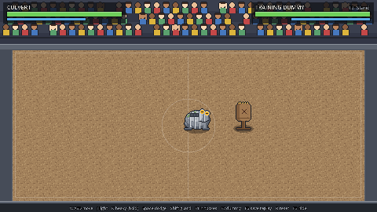

## Play a build

Every pull request gets a **playable build**: a bot comment on the PR links a Windows
and a Linux download (sign in to GitHub, unzip, run). Builds of `main` are on the
[Actions page](../../actions/workflows/playable-build.yml). Windows may warn about an
unknown publisher: choose **More info → Run anyway**.

## Play online (1v1)

**Online** on the title menu. Both players need the **same build**.

- **Quick match:** pick **1 v 1**, **2 v 2** or **3 v 3**, then your fighter on the
  character tiles, and the server looks for whoever is waiting for the same size.
- **Rooms:** **Create room** shows a short code (like `KX7P`): press it (or its copy
  icon) to copy it, then paste it to your friend. They pick **Join room** and type it,
  and the server pairs the two of you. A room stays together: after each match pick
  **Next match**, choose a fighter (or keep yours), and the next match starts once
  everyone has locked in. If your friend leaves, you wait in the same room with the
  same code for someone else; the room closes when the last player leaves. **Watch
  room** with the code follows every match in it, picks included.

Whatever you choose, you pick your fighter first. When the server has a match it shows
**Match found**: everyone has 15 seconds to **Accept**, and the fight starts once all
have. If someone doesn't, the players who accepted go back to searching. Mirror
matches are fine; in a 2v2 or 3v3 the server puts two of the same fighter on opposite
teams when it can.

A **1 v 1** is best of three rounds of 90 seconds, like Versus against the CPU: a K.O.
(or more health left at time) takes the round, then both fighters, the floor and the
clock reset. A drawn round counts for nobody; after five rounds the leader wins. The
Duel 3v3 tag and the team battles stay one round.

The server is `kevarena.duckdns.org` (from `data/online.json`); **Settings > Game > Online
server** changes it. At the server's own house the game finds it on the local network by
itself, since many routers can't loop their public name back inside. The server pairs
players, relays each match and referees it with its own copy of the game. Run one:
[docs/SERVER.md](docs/SERVER.md).

**More** has the rest: play without a server, or join another one.

1. One player chooses **Host a match**. The screen lists their addresses.
2. The other types the host's address on the **Join** row (or pastes it with Ctrl+V) and presses Enter.

How the joiner reaches the host:

- **Same home network:** join the host's `192.168…` address.
- **Over the internet, easiest:** both install [Tailscale](https://tailscale.com) (free for
  personal use); the host invites the other player to their tailnet (or shares their PC
  with them). Join the host's `100.x` address, which shows in the host's list. No router
  changes.
- **Over the internet, port forwarding:** the host forwards **UDP port 7777** on their
  router to their PC, and the joiner uses the host's public IP.
- Windows asks whether to let the game use the network the first time you host: allow it.
- **Another dedicated server:** type its address on the Join row (add `/room`, like
  `game.example.net/kev`, to meet a friend there).

It uses rollback netcode: your own inputs respond at once (after 1–3 frames of delay,
picked from the ping), and the other player's late inputs are corrected in a frame or
two. The bottom corner shows ping, delay and the deepest rollback. Enter / A after the
match asks for a rematch; once both of you have asked, a 1v1 (Quick match, ranked, a
tag Duel, or host/join) goes to the fighter select with your last pick ready, so one
press (or Same again) keeps it. You see only whether your opponent has locked in; once
you both have, the countdown drops to 3 seconds and both fighters show (no changing
now), then the rematch starts. You have 20 seconds: when time runs out, whoever hasn't
locked in keeps their last fighter. Each Quick match rematch is on a new arena (host/join keeps the
host's). Ranked rates every game. In a room it's Next match; Quick match 2v2/3v3
rematch with the same fighters. Esc / View leaves. For testing on one network you can fake a
bad connection: `--net-lag=6 --net-loss=0.1`. Details: [docs/NETCODE.md](docs/NETCODE.md).

## Run it

1. Install [Godot 4.7](https://godotengine.org/download) (standard build, no .NET needed).
2. Open Godot, click **Import**, and pick this folder's `project.godot`.
3. Press **F5** (or the ▶ button). The title menu has **Single player** (every mode against
   the CPU, training, trials and local 2-player), **Online**, **Settings** (Game: CPU level, rumble, screen shake, Discord status, online server; Video: fullscreen, vsync, the
   fight frame rate, 144 fps unless changed; Audio: master, music, effects and menu volume;
   Controls: keyboard layout, range rings, and remapping for both keyboard layouts and the controller) and **Exit**. Menus always
   run at 60 fps. The game itself runs 60 steps a second whatever the frame rate.

From a terminal:

```sh
godot --path .                          # menu
godot --path . -- --mode=0 --level=2    # Cairn vs a Hard CPU Culvert
godot --path . -- --mode=2              # watch CPU vs CPU
godot --path . -- --showcase=cerebro    # scripted demo: cairn, culvert, craglash, barkley, gillbert, cerebro, hissy, digby, pete, sno or counterplay
godot --path . -- --mode=6              # Duel vs CPU with the default teams (add --pick to choose)
godot --headless --path . -- --server   # a dedicated server on UDP 7777 (docs/SERVER.md)
```

Online from a terminal: `godot --path . -- --online-host` and `godot --path . -- --online-join=192.168.1.20`
(`--fighter=gillbert` picks yours). Modes: 0 Cairn vs CPU, 1 Culvert vs CPU, 2 CPU vs CPU, 3 training as Cairn, 4 training as Culvert,
5 combo showcases (each fighter's full kit, then how to answer the big moves, on a loop),
6 Duel vs CPU, 7 Duel for 2 players, 8 Versus for 2 players, 9 Combo Trials,
10 Reaction Drill (read Culvert), 11 Reaction Drill (read Cairn), 12 Craglash vs CPU Cairn,
13 training as Craglash, 14 Barkley vs CPU Craglash, 15 training as Barkley,
16 Gillbert vs CPU Barkley, 17 training as Gillbert, 18 Chef Cerebro vs CPU Gillbert,
19 training as Chef Cerebro, 20 Online 1v1 (the lobby), 21 Hissy Fitz vs CPU Chef Cerebro,
22 training as Hissy Fitz, 23 Digby vs CPU Hissy Fitz, 24 training as Digby,
25 Sneaky Pete vs CPU Digby, 26 training as Sneaky Pete, 27 Sno Mercy vs CPU Sneaky Pete,
28 training as Sno Mercy, 29 Team battle 2v2 vs CPU, 30 Team battle 3v3 vs CPU,
31 Team Deathmatch 2v2 vs CPU, 32 Team Deathmatch 3v3 vs CPU, 48 Mister Crease vs CPU Chef Cerebro,
49 training as Mister Crease. `--teams=craglash,cairn,culvert:culvert,cairn,craglash`
sets Duel (and Team battle) teams; `--cpu-vs-cpu` hands every player side to the CPU (`--view-team=N` then shows it as team N sees it: brush, fences and walls hide the other side).

**Local 2-player:** with two controllers, each player gets one (player 1 can also use the
keyboard). With one controller, player 1 uses keyboard and mouse and player 2 the controller.
CPU levels: 0 Easy, 1 Normal, 2 Hard, 3 Rage.

**Rage** is the top tier, absurdly good on purpose. It presses buttons like any CPU, but:

- **Reads everything.** It watches every foe's frame data and projectiles. It steps out
  of reach when there's time, times its dodges so the invincible frames cover the hit,
  sidesteps shots and gets out from under lobs.
- **Punishes every opening.** It hits back on whiffs and blocked swings, and only throws
  a jab that can't be walked away from or out-traded.
- **Never wastes anything.** It never drops a combo, picks the best route it can afford,
  leads its shots, and saves its energy for a Surge unless a breakaway is worth more.
- **Moves smart.** It walks around holes and out of corners.
- **Plays each fighter by its class** (its `role`, or `"style"` in its `ai` block):
  - **mage:** kites at the edge of its range, strafing so it keeps facing you and
    throwing while it backs off. It flips you away or blinks off when you get close.
  - **assassin:** hovers just out of reach, then bursts in (Burrow, Tiptoe, a dash) for
    a full combo and gets out. In team battles it hunts the weakest foe.
  - **tank:** walks you into the walls, uses its armored taunt up close, and in team
    battles goes after whoever is on its most hurt teammate.
  - **bruiser:** constant pressure, pokes and lobs.
  - **skirmisher:** hits and runs at poke range, diving in when the foe is stuck.
  - **fighter:** footsies at the edge of your reach, parrying with its counter.
- **Chases kiters.** Against a fighter that attacks from range, everyone except a mage
  runs it down: it heads for where the kiter is going, weaves through the shots and
  uses gap closers.

`tests/bench_cpu.gd` pits any two levels against each other across the roster (Rage
beats Hard about 98% of the time). Rage against Rage shows the kits' balance:
`--matrix` prints every pair, `--pairs=a:b,c:d` just those, both with `--seeds=N`.

### Class balance

The roster is balanced **within each class** (mirrors close to even) and along a class
triangle: **assassins beat the mage; the mage beats fighters and tanks; fighters beat
assassins.** Measured Rage against Rage (the only CPU that plays each kit the way it's
meant to be played), checked by `tests/test_balance.gd`:

| Matchup | Rage vs Rage |
| --- | --- |
| Digby vs Chef Cerebro | 70–75% Digby |
| Sneaky Pete vs Chef Cerebro | about 25% Pete |
| Chef Cerebro vs Cairn, Hissy Fitz, Culvert, Craglash | 75–100% Cerebro |
| Cairn or Hissy Fitz vs an assassin | 60–100% the fighter |
| Craglash vs Culvert (tanks) | about 10% Craglash (his pits; 30–45% before Craglash's balance pass) |
| Digby vs Sneaky Pete (assassins) | about 90% Digby (not pinned) |
| Hissy Fitz vs Cairn (fighters) | about even |
| Barkley vs Sno Mercy (bruisers) | 25% Barkley at Rage, 75% at Hard |
| Mister Crease vs Chef Cerebro (mages) | about even (40–60%) |
| Mister Crease vs Cairn, Hissy Fitz, Culvert, Craglash, Barkley, Sno Mercy | 90–100% Crease |
| Digby vs Mister Crease | about 60–70% Digby; Sneaky Pete loses to him like he loses to Cerebro (not pinned) |

Tanks against assassins went to the assassins (Pete especially): a slow tank can't
catch a fighter who vanishes, which fits the classes. Hard CPUs don't kite, so Chef
Cerebro loses almost everything at Hard; that's the CPU, not the kit.

## Controls

An **Xbox controller** works any time. For keyboard and mouse, pick a layout in the menu
(**Keyboard: League-style** or **Classic**); the choice is saved. On-screen prompts follow
whichever device you used last.

| Action | Xbox controller | League-style (mouse + QWER) | Classic keyboard |
| --- | --- | --- | --- |
| Move | Left stick / D-pad | Right-click the ground (hold to steer) | WASD / arrows |
| Aim | Right stick (optional) | Mouse cursor | Movement direction |
| Light attack | A | A or left-click (toward cursor) | J |
| Auto-attack | — | Right-click the opponent | — |
| Heavy (hold to charge) | X | E (aim with the mouse while charging) | K |
| Skill 1 | Y | Q | U |
| Skill 2 | B | W | I |
| Surge | RT | R | O |
| Dodge roll | RB | D or Space (toward cursor) | Space |
| Guard | LB | F or Shift | Shift |
| Breakaway (while stunned) | LB + RB | D + F | Shift + Space |
| Tag (Duel) | LT | T | L |
| Stop | — | S | — |
| Pause (in a fight) | Start or View | Esc | Esc |
| Menus: select / back | A / B | Enter or click / Esc | Enter / Esc |

The pause menu (Resume, Restart, Controls, Quit to main menu) freezes the match; quitting
or restarting asks first. After a match: Rematch, Change fighters or Main menu.

Duels and 2-player Versus open a character select: every fighter in a grid with a
cursor per player. Two players pick at the same time, each with their own controller
(player 1 also has the keyboard and mouse); against the CPU you pick your team, then
the CPU's. B / Esc takes the last pick back, "?" (or Y / R) picks at random. Online the match can't stop, so pausing asks whether to leave
while the match carries on (your fighter stands still meanwhile).

Controllers rumble on hits, slams, Surges and knockouts (Settings > Game turns it off).
Every key and button above can be remapped in Settings > Controls; the on-screen
prompts and the controls strip follow your bindings.

**Moving and aiming are 360 degrees.** The left stick walks exactly the way it points
(and attacks go that way when nothing else aims them); a right-click walks straight to
the spot. The mouse aims attacks exactly at the cursor. Controllers have two layouts
(Settings > Controls > **Controller**):

- **Standard:** the right stick aims an attack exactly where it points as you throw it.
- **Twin-stick:** the right stick aims exactly where it points and, while held, keeps you
  facing that way as the left stick walks you anywhere (strafing, at 85% speed). Back off
  or circle an opponent without turning your back. **Chef Cerebro** plays it like a
  twin-stick shooter: pushing the right stick on its own **throws his light string that
  way, over and over**, while the left stick glides him around (his lights don't stop him
  walking). Any other attack, dodge or guard pauses the auto-throw for a moment so that
  button always comes out.

WASD still gives 8 directions, so the keyboard gets a small **aim assist**: an attack
aimed within 25° of an opponent within reach goes straight at them (12° from the left
stick, which needs less help). A chevron on the floor shows exactly where each fighter
faces. The CPU walks and aims 360 degrees on Normal and up (Rage also leads its shots), and in 8 directions on Easy. `--showcase=twinstick` shows strafing and an
off-angle Landslide Charge; `--pad-layout=twinstick` picks the layout from the command line.

Tools: F1 hitbox overlay, F2 cycle the training dummy, F3 hide the controls strip,
F4 reset training, F5 next palette (Arcade clears unlock them), F6 save a replay (watch it from
Single player > Replay theater), F7 range rings, F8 change fighter (training), M mute music.

**Range rings** (Settings > Controls, or F7 in a fight; off by default): a thin ring on the
floor under each attack while it can hit, in the attacker's colour, showing where a foe's
centre has to be to get hit (the hit circle plus a standard body), fading just after. Shots
get one too, and a lobbed Pinecone Bomb shows its ring where it will land. A faint ring under
each fighter marks its own body. F7 can be rebound in each Remap page (the controller has no
button for it until you pick one); it works alongside the F1 overlay.

## Arenas

Single player's **Arena** row (or `--arena=ID`) picks where every offline match is fought.
Each map in `data/arenas/` lays fixed pieces on the breakable floor:

| Arena | What's on the floor | Who gets through |
| --- | --- | --- |
| Stadium | Plain dirt, the pits you make | Everyone |
| Quarry Bowl | Two rubble walls split it into three lanes, open at the top and bottom. Walls stop bodies and shots (lobs fly over), bounce knockback like the edge and block sight: a foe behind one isn't on your screen (a faint "?" marks where your team last saw it) | Craglash's Landslide Charge and shoulder-charge dodge and Cairn's Rockslide Rush smash through (the wall rebuilds after 12 s) |
| Floodgate Stadium | A shallows channel down the middle with two bridges. Shallows slow walking to 60% | Culvert wades at full speed; Gillbert's Flop Dash and Sno's Slush Slide run 1.5x faster through it |
| Greenhouse Dome | Fence lines and brush beds. Fences stop bodies, not shots, and you can't see through them; brush hides whoever stands in it from the other team (not drawn at all on their screen) until one of them is right next to it, it attacks, or it lands or takes a hit (then for half a second). You see yourself and your teammates in brush, faintly | Sneaky Pete's Pickpocket ghosts through fences, Chef Cerebro blinks over them, Digby burrows under everything; any dash or roll flattens brush (grows back) |

Chasms (pits that never heal) are a map piece too; leaps and Burrow cross them. The CPU
finds its way round walls, fences and chasms on every level, and plays by the same sight
rules: a foe its team can't see is hunted where it was last seen.

## How combat works

Every fighter has five attack types, ranked: **Light (1) → Heavy (2) → Skill (3) → Surge (4)**.
Lights chain into the next light in their string. **Only the last hit of a light string
staggers** (the third; Cairn's Hook, the fourth): the hits before it only deal damage, with no
hitstun, no push and no combo started, so the other fighter can answer between them.
Craglash is the exception: every hit of his slower string staggers. A jab still interrupts a
big move's windup, and still catches an invisible Pete; thrown knife flicks do neither.
**Fights happen at arm's length, not on top of each other:** lights reach about 16 px
past the two bodies, and a light's forward step stops once the foe is at the strike's
sweet spot (it still steps in after a foe that the last hit pushed back), so a string
keeps its spacing and you can see the other fighter's windups.
Any move that **hits or is blocked** can
cancel into a move of a higher rank, so combos climb the ranks. The exception: a **blocked
third light** (or later) can't be cancelled, and leaves the attacker at least 16 frames
behind the blocker ("OPEN!" pops up over them), time enough to punish with a jab.

**Stamina pays for dodges and blocks.** A dodge costs **60% of the stamina bar**, so you get one, then a wait. A blocked
hit chips a little health and drains stamina: lights drain less, heavies more, and every
blocked hit holds stamina regen off for half a second, so you can't recover under pressure.
At **0 stamina you're exhausted**: you can't start a guard, a guard you're holding drops and
the hit that emptied it lands clean ("EXHAUSTED"; no extra stun), and regen waits 2 seconds.
The stamina bar flashes red while you're exhausted. The numbers are in `data/rules/stamina.json`.

**Shots are easy to land:** every straight projectile hits in a wider circle than it's drawn
(`radius_mult` in `data/rules/projectiles.json`), and the two hooks, Gulp and Mountain Maw,
widen toward the end of their reach.

**Mixing types pays.** Each hit is multiplied by how many different types have landed in the
combo so far: ×1.0, ×1.15, ×1.3, ×1.5. **Limits keep it fair:** a move repeated in the same
combo does half damage, hitstun shrinks with every hit, launched targets take at most three
juggle moves, and a stunned fighter can spend 50 energy on a **breakaway**.

Energy fills as you deal and take damage (about one Surge per round). A Surge's own hits
never charge the next Surge. When a meter fills, that fighter bursts into a **power-up
aura** in their own colours (pillars of light, then a flickering flame shell and their
own motes: Cairn's stones, Sno's snowflakes, Pete's gold glints...) that stays until the
Surge is spent. Your side hears a rising power-up; the other side's sounds a low warning.

### The arena

The floor is 672 x 288 px, 1.5 times its first size, inside a stadium wider than the
screen. The camera follows the fight: at the normal 1x while the fighters are close, and
pulling back (as far as the whole stadium) to keep everyone, heads included, in shot.

### Health bars

Every fighter's health bar floats over its head, League-style: **green** is you, **blue**
your teammates, **red** your opponents (with nobody playing here, or two players on one
screen, they're the side colours: red left, blue right). Ticks mark every 25 health, a pale
chunk shows what a hit just took before it drains away, pale stone on the end is a shield
(Craglash's Stoneskin), and the thin yellow strip underneath is the Surge meter. The panels
at the top keep the Surge meter, stamina and skill cooldowns.

### Fighting from every angle

Fighters move and attack in any direction, not just left and right: every hitbox goes
where the fighter faces, and **every hit reaches the same distance all the way around**
(hits are circles on the floor; `tests/test_movement360.gd` measures each fighter's
reach in eight directions). Effects on the floor (rings, swings, landing marks) are drawn
as true circles, the same size the hit really is, and a swing straight up or down is
drawn at the feet, where its hit is. Each fighter has side, front (facing down the screen) and back
(facing up) art, so a Lash aimed down the screen comes at the camera and one aimed up
reaches away behind the body. A tall fighter standing in front of a shorter one turns
see-through so the one behind stays readable. `--showcase=angles` shows it.

**Steering:** attacks aim where you hold. Every hit of a light string turns to the
direction held when it comes out, and a light can still be re-aimed until its strike
comes out, so a string can start on one side and finish on someone behind or below you.
A raw big move that winds up stays pointed where its tell showed (so rolling away from
it still works); cancelled into from a hit, it goes where you hold. A move can be given
its own steering window with `"aim_frames"` in its JSON.

### Duel: 3v3 tag

Each side picks three creatures (repeats allowed while the roster is small); one fights
at a time.

- **Tag** sends the next living teammate in with its own tag-in strike (Cairn: Rockfall
  Entry, a dash punch; Culvert: Manhole Drop, a landing slam that launches; Craglash:
  Landslide Entry, a charging headbutt; Barkley: Timber Drop, a falling log bonk that launches; Gillbert: Splashdown, a little belly-flop;
  Chef Cerebro: Order Up, a mallet bonk that launches; Hissy Fitz: Hiss Off, an uppercut
  that launches; Digby: Pop Goes the Mole, bursting up out of the floor; Sneaky Pete: Smash and Grab, a
  bag swing; Sno Mercy: Cold Shoulder, a sliding barge that slows). Tag from
  neutral or guard, then it's on a 5-second cooldown.
- **Tag cancel:** tag out of an attack that hit, for 50 energy, and the tag-in strike
  carries the combo on.
- **Bench healing:** a benched creature heals 1.5 HP a second, up to 25% of its max above
  where it tagged out.
- **Knockouts:** when your active creature goes down, the next one enters after the death
  animation. Lose all three and you lose; at the 3-minute time limit, the team with the
  most health left wins. Energy and stamina belong to the team.

All of this runs in the deterministic simulation (`src/sim/duel_sim.gd`), so a Duel can
be played online with rollback exactly like a single match. Tuning: `data/rules/duel.json`.

### Team battle: 2v2 and 3v3

Every creature is on the field at once, one per player: you play the first fighter of the
red team and CPUs play your teammates and the blue team. Online, **Quick match 2v2 / 3v3**
(or a room with a room size) puts a player on every slot, each on their own machine. If
nobody else turns up within 20 seconds (45 for a room), the server's CPUs take the empty
slots, and a CPU takes over for anyone who leaves mid-match.

- **No friendly fire:** your hits, projectiles, bursts and ice puddles pass over
  teammates, and moves that pick a target (taunts, gazes, homing dashes, blinks, aim
  assist, the CPU) only ever pick a foe.
- **One life each:** a knocked-out fighter stays down; the fight goes on with a short
  slow motion. The last team with anyone standing wins. At the 2.5-minute limit, the team
  with the bigger share of its health left wins.
- **HUD:** your fighter keeps the full panel (skills, Surge, stamina); everyone else gets
  a small card with health and energy, down their team's side of the screen.

It runs in the deterministic simulation (`src/sim/team_sim.gd`, `CreatureSim.team`), so it
rolls back like a Duel. Tuning: `data/rules/team.json`.

### Team Deathmatch: 2v2 and 3v3

Single player > Team Deathmatch vs CPU. The same teams on the same field, but nobody stays
down.

- **Unlimited respawns:** a knocked-out fighter comes back after **4 seconds** at full
  health, keeping its Surge energy.
- **Spawn pads, one per fighter, against each team's own side wall** (red left, blue
  right), drawn on the floor with a countdown while you wait. You come back facing into
  the arena, **invulnerable for 2 seconds or until you attack**, so a pad can't be camped
  but you can't hide on it either.
- **Score:** every KO is a point for the other team. First to **12** (2v2) or **15**
  (3v3) wins; at the 3-minute limit, the higher score wins, and a tie goes to **sudden
  death** (the next KO wins).
- The match starts in the middle as usual; the pads are only for coming back.

Offline for now (vs CPU); online Team Deathmatch needs the server to run the mode.
Tuning: `data/rules/deathmatch.json`.

### Training

Single player > Training puts your fighter against a dummy with no clock. F2 (or the
pause menu) picks what the dummy does: stand, guard, walk or dodge; F4 resets. The pause
menu adds:

- **Change fighter** (or F8, rebindable in each Remap page; the controller has no button
  for it until you pick one): the pick screen's tiles, one fighter for you. Picking one
  swaps your fighter in place with a short fade: the dummy's behaviour, the arena and the
  training options stay. Restart and F4 keep the new fighter until you leave training.
- **Training options:** *No cooldowns* (every move and the dodge are always ready, and
  your stamina stays full, since most dodges are gated by stamina), *Surge always full*
  (your Surge meter stays at max) and the *Dummy* row (the same setting F2 cycles). They
  apply to you, not the dummy, show as tags under the dummy's panel, and are remembered
  in your settings. They exist only in training: no other mode, Combo Trials and Reaction
  Drills included, can turn them on.

**DPS meter:** the dummy's panel shows the damage you do to it per second, with the
burst's total and length under it ("DPS 16.7", "40 dmg 2.4 s"). A burst starts at your
first damage and ends after 2.5 s without any; its DPS is the total over the time from
its first damage to its last (at least a second, so one hit reads as its damage). The
number is gold while the burst is going and stays, dimmed, until your next hit starts a
new one. Everything that takes the dummy's health counts: clean hits, block and armor
chip, projectiles, poison, falls; the dummy refilling after a KO doesn't. Paused time
doesn't count.

A training replay (F6) records the options and every change you make to them, so it plays
back exactly; swapping your fighter starts a fresh replay from the swap.

### Learning the game: Combo Trials and Reaction Drills

- **Combo Trials** (`data/trials.json`, 19 so far): each trial plays a demo of the route,
  then it's your turn. Every move must come out in order and connect, and the combo can't
  drop. The caption shows the route with your buttons and ticks off each move. F2 shows
  the demo again, F4 skips to the next trial.
- **Reaction Drills:** the partner throws random raw big moves; answer red by rolling
  away (or hitting first) and gold by guarding. 20 reps, scored with your streak and
  average reaction time from the tell. *Read Culvert* mixes Gulp, Slam and Runoff;
  *Read Cairn* mixes Rockslide Rush and Haymaker.

`tests/test_trials.gd` clears every trial with real inputs and runs both drills.

### Windups: reading the big moves

The high-reward moves wind up first when thrown **raw** (from neutral or out of guard), so
there is time to see them coming. Cancelled into from a move that hit, they come out at
full speed, so every combo below still works.

| Glow | Means | Moves (windup) | Answer |
| --- | --- | --- | --- |
| **Red** + "!" | Can't be blocked | Gulp (12f), Branch Grab (8f), Slam (8f, breaks guard), Flip Out (12f), Mountain Maw (12f, the hook), Coil Uppercut (8f, breaks guard), Slush Slide (8f, breaks guard), Burrow's pop-up (breaks guard) | Roll away or through it, or hit them first |
| **Gold** | Strong but blockable | Rockslide Rush (12f), Haymaker (8f), Runoff (6f), Rockslide Stomp (18f), Landslide Charge (14f), Timber Twister (8f), Splash Zone (8f), Flop Dash (12f), Cast Line (6f), Tenderize (8f), Cleaver Toss (6f), Sack Smack (8f; held to a full charge it flashes red with "GUARD BREAK" and breaks guard) | Guard, then punish |

That puts at least 15 frames (a quarter second) between the glow and the hit, and a jab
landed during a windup cancels the move. Surges freeze the screen for their cut-in: a
dodge pressed during the freeze comes out the moment it ends.

### Cairn — stacked-stone boxer

| Button | Move | What it does |
| --- | --- | --- |
| Light | Jab, Jab, Cross, Hook | Fastest string in the game |
| Heavy | Haymaker | Uppercut that always launches |
| Skill 1 | Slip | Weave; if a strike lands in the window, counter with a Cross that crumples. Loses to grabs |
| Skill 2 | Rockslide Rush | Dash punch; the main combo extender |
| Surge | Avalanche | Six-punch flurry and a launching uppercut |
| Passive | Stack | Each landed light adds a stone (max 3); Haymaker and Rush spend them for +4 damage each |

### Culvert — storm-drain toad

| Button | Move | What it does |
| --- | --- | --- |
| Light | Jab, Jab, Hook | Slow, heavy string; the Hook can wall-bounce |
| Heavy | Slam | Cracks a block of floor 5 cells deep by 5 across **in front of him, clear of his own feet** (a wall across his facing; the same block wherever it lands; a second Slam there opens it into a rectangular pit); a full charge opens it at once. Breaks guard. His pits stay open 18 s, half as long again as anyone else's |
| Skill 1 | Gulp | His **tongue shoots out about 130 px**, out and back in the same 13 frames as before (it flies faster), red tell, can't be blocked. **Tapped: a hook** that stuns whoever it catches and **hauls them in** to him, like a grappling hook. **Held (about a third of a second): he swallows them** whole, and a moment later they come out the back end with a plop, skidding away behind him (12 damage, where the hook does 6). Holding works on every layout: Q, Y on a pad, or U on the classic keys. The tongue chases down its lane, so **sidestep it** or roll through; rolling straight away doesn't outrun it |
| Skill 2 | Runoff | **Tapped: a short shove** right in front of him (3 damage) that **knocks the foe well back**. **Held (a fifth of a second): the wave**, a sheet of water in a cone in front of him that hits everything in it, pushes it back, does 9 damage and **slows** it (walk ×0.6 for 2 s). After a Slam, hold it: the Slam knocks them out of the shove's reach |
| Surge | Storm Drain | Leaping slam that hits all around and leaves a ring of pits (18 s, like his Slam's) that starts **right at his feet** and reaches 52 px out. Swallow someone straight after and they come out the back end into a pit |

A squat toad cast in storm-drain concrete: amber eyes, a mouth that opens into a drain
with iron bars across the jaw, a manhole cover on his back, and big back legs he hops on.
His roll covers twice the ground of anyone else's in the same 20 frames.

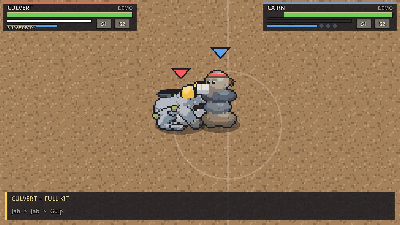

### Craglash — the mountain that woke up angry

A crowd-control tank (175 HP, heavy, hard to push). His slow, heavy swings don't win
races, so he controls where the fight happens instead: he hooks the backline in from
across the floor, stuns, launches, and with a full meter drags everyone near him into a
three-second lockdown while his team does the damage.

| Button | Move | What it does |
| --- | --- | --- |
| Light | Rake, Backhand, Headbutt | Two claw swipes, then the neck snaps the head forward. **Slow and heavy**: about half the speed of anyone else's string (18, 16 and 23 frames to hit, against 4–5 for most fighters) but they hit harder, and **every hit staggers** (the only string that does) for long enough that the string is still a true combo |
| Heavy | Rockslide Stomp | Slams the ground and knocks up everyone close, all around him (16 frames to land out of a combo, a slow recovery). **Armored** once its windup is over: a jab only chips it (thrown raw, its tell can still be jabbed; out of Bedrock it comes out armored) |
| Skill 1 | Landslide Charge | A slow, heavy shoulder charge about 65 px forward that **stuns** whoever it hits for a quarter second (crumple), long enough to follow up. A gold windup tell |
| Skill 2 | Mountain Maw | The hook, on a 5 s cooldown. His head shoots out on its stone neck, **far** (about 160 px), and **can't be blocked**: it has to be dodged. It bites the first foe it reaches and **hauls them back** to his feet, **crumpled**, so a Rake (or a teammate) follows. A red tell and a dotted lane show it coming |
| Surge | Bedrock | Roots in place for 3 s: hits only chip him (75% less damage) and nothing moves him. Every foe within 140 px is **taunted** for 3 s: they walk at 60% speed, their attacks swing at him, and they're **dragged in** toward him, hard. Any attack button answers out of it after 18 frames, so the Stomp meets them as they arrive. Loses to grabs. A tank's meter fills from the hits he takes, so soaking damage is what earns it |
| Passive | Stoneskin | A 30-point stone shield that soaks damage first; it grows back only after **7 s out of combat**: no damage taken and none dealt (his hits and chip count too), so it doesn't refresh mid-brawl. Shown as a pale rim on him and as pale stone on the end of his health bar ("STONESKIN") |
| Dodge | Landslide Ram | His roll is a shoulder charge: **twice as far** as anyone's (about 90 px) and it costs 60% of his stamina, like any dodge. The first foe it reaches is **hit** (4 damage, a short stun that a Rake links after, and it counts in the combo) and the dash stops there. Running into the wall stops it too and cracks the floor. Still invincible in the middle, like any roll |

### Barkley — the tree that got up and left

A bruiser (145 HP, Wild affinity, slow on his roots) with long branch arms: he pulls foes
in, spins, and fills the space around him with pinecones and roots.

| Button | Move | What it does |
| --- | --- | --- |
| Light | Twig Swipe, Bough Swing, Log Drop | Both branch arms swing across, then he tips forward and bonks with the log on his head |
| Heavy | Timber Twister | Arms out, he spins on his roots: three hits all around him, the last one knocks up and away. Hold to charge (more damage, throws farther). Can't be cancelled until the last hit. **Armored** while it spins: hits only chip him (half damage) and don't stop it, though the windup can still be interrupted. A 2.5 s cooldown |
| Skill 1 | Branch Grab | A branch arm shoots out to long range, snags, and **reels the target in** to point-blank, still stunned, so a light string links after it. A **grab**: it can't be blocked (red warning), so dodge it; it misses a target in the air |
| Skill 2 | Pinecone Bomb | Lobs a pinecone; it bursts where it lands in a **wide** burst (32 px around the spot), popping up everything in it, even a foe right beside him on the shortest throw. **Tap** for the shortest throw (about 54 px), **hold** to throw it further (up to about 115 px): a ring on the floor slides out to show where it will land. On release it **turns toward a foe** within about 45° of where you aimed |
| Surge | Root Eruption | Plunges his arms into the floor: roots burst out in three growing rings (26, 40 and 54 px), all around him; the last ring stuns. Cracks the floor but opens no pits |

The sheet gives Barkley no passive, so he has none.

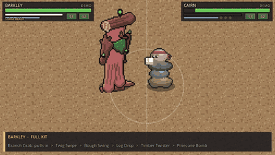

### Gillbert — the one that got away

A small, quick skirmisher (110 HP, Tide affinity, the fastest walker). He flops across the
floor like a landed fish, his rod tumbling behind him on the line.

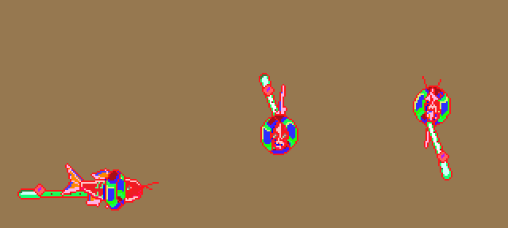

| Button | Move | What it does |
| --- | --- | --- |
| Light | Snout Jab, Tail Whip, Rod Flail | A nose bonk, a half turn that lashes the tail across, then a jerk of the head swings the rod over him onto the foe |
| Heavy | Splash Zone | Curls up and slaps the floor with his tail: hits all around him, pops foes up and **slows** them (walk ×0.6 for 2 s). Hold to charge (bigger and harder) |
| Skill 1 | Flop Dash | A long skidding belly-flop forward (about 100 px in a quarter of a second), kicking up water; keeps a juggle going |
| Skill 2 | Cast Line | **Throws his rod** on its line, about 220 px. If it hooks someone he's **reeled in to them** at a steady pull, across pits and all, like a fish on a line; arriving ends the cast while they're still stunned, so lights link straight after. Blockable; a miss leaves him stuck in recovery |
| Surge | The One That Got Away | Leaps straight up off the screen, **out of reach** of everything (he sails over bodies and pits), then belly-flops in a huge splash that knocks foes down. The mark **follows the nearest foe** while he's rising (up to about 70 px), then locks, so a dodge on the landing still beats it |

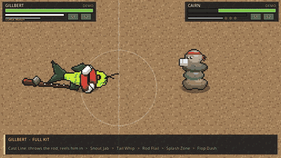

### Chef Cerebro — a floating brain that cooks with its mind

A mage (105 HP, Lumen affinity). He floats a hand's height off the floor with his
kitchen hovering around him (big knife, spatula, meat mallet, a fan of paring knives) and
throws it all with his mind: whatever he's moving glows violet, and so does he.
**Dodge: Mind Blink.** Instead of rolling he teleports: a short delay (5 frames, already
untouchable from the 3rd) and he's simply 116 px away the way you pushed, stopped by the
walls but not by pits (blinking onto a hole drops him in). It **recharges for 0.75 s** after
each blink (a violet bar beside his stamina drains away; a dodge pressed just before it's
ready comes out when it is). **Most of his attacks are thrown, and
his skills reach 120–130 px (about half Gillbert's Cast Line), his lights half again as far (about 170 px)**, so he wants foes at knife
range; up close he softens them up or flips them away. Voice line: "CHOP CHOP!"

| Button | Move | What it does |
| --- | --- | --- |
| Light | Knife Flick, Backhand Flick, Mallet Toss | Two small knives and then the meat mallet, all **thrown** about 170 px, and he **keeps gliding** while he throws them (at 60% speed, any direction). On the Twin-stick layout the right stick throws them on its own. The knives only chip: they **don't stagger**. The Mallet Toss at the end of the string is the hit that staggers, so Flick, Flick, Mallet → Cleaver Toss → Knife Flurry works from across the floor (within the Cleaver's 120 px) |
| Heavy | Tenderize | Pounds the floor with the mallet: hits everyone close, all around him, pops them up and **tenderizes** them (they take 20% more damage for 4 s; a pink arrow shows it). Hold to charge (bigger and harder) |
| Skill 1 | Cleaver Toss | Flings the big knife in a straight line, about 120 px; it hits the **first** foe in its path. Keeps a juggle going |
| Skill 2 | Flip Out | Scoops a close foe with the spatula and **flips them over his head**, to land behind him; he turns to follow. A grab: it beats guard (red tell) |
| Surge | Knife Flurry | A stream of eight knives in a straight line, about 130 px, that fly **through** everyone in the line; the last one knocks down. It **aims at the nearest foe** within about 65° of where he faces (every knife tracks them), so they needn't be lined up on one of the 8 directions. A dotted line on the floor shows the lane during the startup |

The sheet gives him no passive, so he has none. His victory emote (hibachi tricks) waits
for a victory-pose system.

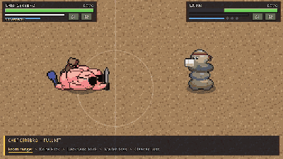

### Hissy Fitz — kicked out of the museum for turning the guards to stone

A fighter (130 HP, Wild affinity: the sheet says Poison). A big head crowned with hair
snakes that floats around the arena, two red boxing gloves held up in guard on two more
snakes. She wins up close with
quick gloves, and makes foes pay for walking in: the spit poisons them on the way, and the
gaze slows anyone who comes at her face first. Voice line: "Hiss off!"

| Button | Move | What it does |
| --- | --- | --- |
| Light | Snake Jab, Snake Jab, Hair Lash | A fast one-two from the gloved snakes, then her hair snakes whip forward and bite |
| Heavy | Coil Uppercut | The glove coils low and comes up under the guard: **breaks guards** and launches. Hold to charge (bigger and harder) |
| Skill 1 | Venom Spit | Her hair snakes spit a glob of venom about 100 px. It **poisons**: 2 damage every half second for 3 s (12 in all), outside any combo, so it keeps ticking after the combo ends. Green bubbles show it. Keeps a juggle going |
| Skill 2 | Stone Gaze | She stares for about 1.5 s. Anyone within 110 px, **in front of her and facing her**, is slowed, more the longer they look (down to 35% speed), and stays slowed 1.5 s after. **Look away, or get behind her, and it does nothing.** She can break out of the stare with any attack after the first moments |
| Surge | Petrify Punch | A wound-up haymaker (a long, readable startup). The foe it hits is **turned to stone** for 1.5 s, stunned where it stands, even out of the air. The next clean hit **shatters** the statue for 25% extra damage |
| Passive | Venom Frenzy | **Land 4 hits in one string** (jabs count; each within 0.75 s of the last) and she goes into a frenzy for 5 s: venom drips off her snakes, and **every clean hit stacks poison** on the target (up to 5 stacks, green pips at its feet). Each stack adds 0.6 damage a pulse, two pulses a second, for 3 s after her latest hit; Venom Spit's poison adds on top. Another 4-hit string starts the 5 s over |

There's no passive on the sheet, so she has none. Her victory emote (a kiss blown while
the hair snakes bump gloves) waits for a victory-pose system.

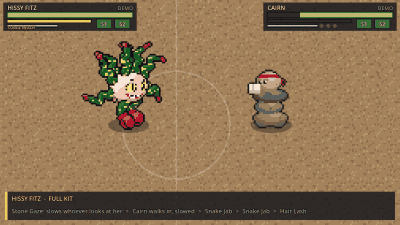

### Digby — digs well. Digs VERY well

An assassin (105 HP, Stone affinity: the sheet says Ground, quick on his feet). A long,
low mole on all fours in an orange miner's helmet, with big yellow claws, a bushy tail and
a pickaxe. He picks his moment: tunnel in out of reach, blind the foe, punish the miss.
Voice line: a placeholder "I DIG IT!" (see the PR).

| Button | Move | What it does |
| --- | --- | --- |
| Light | Claw Swipe, Claw Swipe, Pickaxe Swing | A quick double slash with his claws, then the pickaxe |
| Heavy | Pickaxe Pop-Up | He digs in and bursts up **under a foe about 40 px ahead** with the pickaxe: launches. A ring on the floor marks the spot. Hold to charge |
| Skill 1 | Headlamp Flash | Flicks on his helmet light: a foe it catches is **blinded**, and **their next attack misses** (or the blind wears off after 4 s). Guarding stops it |
| Skill 2 | Burrow | Dives underground and tunnels about 115 px, **steered with the stick**: out of reach, under bodies and across pits, under a moving mound of dirt. Pops up at the end and knocks up whoever is on top; an uppercut from below, it **breaks guards** |
| Surge | Cave-In | Rears up and slams the floor: the ground caves in all around the spot ahead, damaging and **rooting** everyone caught for 2 s (they can still attack and guard, but can't walk or dodge) |

No passive on the sheet. His victory emote (jumping out of the ground with a flip) waits
for a victory-pose system.

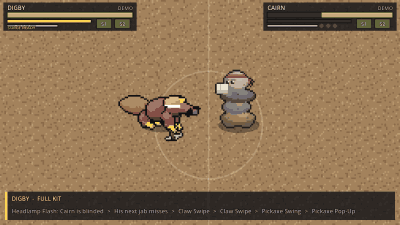

### Sneaky Pete — robbed every bank in town, twice

An assassin (95 HP, Lumen affinity: the sheet says Dark). A cartoon burglar always on
tiptoe: black eye mask, orange striped beanie, and a big green money bag over his
shoulder. He wins by not being where you're looking. Voice line: "Finders keepers!"

| Button | Move | What it does |
| --- | --- | --- |
| Light | Sucker Punch, Cheap Shot, Bag Swing | Two quick jabs, then the bag comes round |
| Heavy | Sack Smack | A big wound-up swing of the money bag that knocks the foe well back. Hold to charge: tapped it's an ordinary heavy that can be blocked; **held to a full charge it breaks guards**, and he flashes red with "GUARD BREAK" over his head the moment the charge is full |
| Skill 1 | Tiptoe | He sneaks forward and goes **invisible** for 3 s (a faint shimmer is all you see) and **55% quicker**. A staggering hit gives him away (a knife flick doesn't); so does his own attack, but only as it lands, and that **ambush hits 35% harder**. The CPU loses track of him and goes where it last saw him |
| Skill 2 | Pickpocket | A low dash that **steers onto** the nearest foe, runs right **through**, hits on the way past and **steals 20% of their attack power** for 5 s: his hits land 20% harder, theirs 20% softer. A gold windup tell gives it away |
| Surge | The Big Heist | A puff of smoke and he's gone, then he **reappears behind the foe** (on their far side if the spot behind is a pit or a wall) for a flurry of bag hits and a big finishing smack that knocks down |

No passive on the sheet. His victory emote (dumping out the bag and throwing the cash in
the air) waits for a victory-pose system.

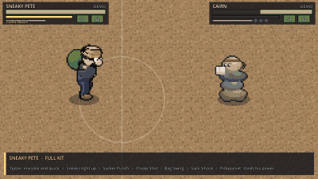

### Sno Mercy — dropped on the sidewalk; now he makes everyone else cry

A bruiser (125 HP, Tide affinity: the sheet says Ice, slow and heavy). A snow cone with a
red-and-green shaved-ice top, an angry face, stick limbs, red boxing gloves, and syrup
dripping off his point. He makes the floor and the foe slow, then hits hard. Voice line:
"Chill out."

| Button | Move | What it does |
| --- | --- | --- |
| Light | Cold Cross (jab, cross), Brain Freeze | A frosty one-two that **slows** (walk ×0.75 for 1 s), then a headbutt with the icy top |
| Heavy | Shaved Ice Spray | He shakes his head and sprays ice shards in a **cone in front of him** (about 46 px, wider charged): damage and a strong slow (×0.6 for 1.5 s). Nothing behind him is hit. Hold to charge |
| Skill 1 | Syrup Slick | Leaks a **sticky puddle** 160 px across around him that lasts 7.5 s: foes standing in it walk at 42% speed. He isn't slowed by his own syrup |
| Skill 2 | Slush Slide | Slides forward feet first on his own slush, about 75 px, **through a guard**, and **knocks down** the first foe he hits. A red windup tell gives it away |
| Surge | Flavor Blast | Rears back and slams his head into the floor: everyone around him (all sides, about 50 px) is **frozen solid** for 1.5 s, and the next clean hit **shatters** the ice for 25% extra damage, like Hissy Fitz's statues |

No passive on the sheet. His victory emote (licking the syrup off his glove, then
shivering) waits for a victory-pose system.

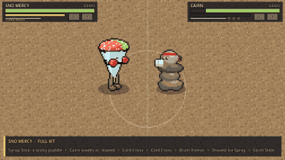

### Mister Crease — folded from a magician's last playbill

A mage (92 HP, Gale affinity: the sheet says Flying; he's the first Gale fighter). Folded
paper all over: a huge pleated orange hat with nothing under it but shadow and a red
collar point, a navy suit cut in panels, a maroon vest and cape, orange paper shoes.
He's paper, so he's light (weight 0.75): knockback carries him further than anyone.
Voice line: "Fold 'em." (a shout on his Surge for now).

**Paper Stock (passive):** he holds up to **3 sheets**, floating over his hat (and as
pips on his panel); one regrows every **5 s**. **Fold, then use:** his Heavy, Skill 1
and Skill 2 are crafts. The **first press folds** the craft (a sheet, a short animation;
a hit before it's done cancels it and gives the sheet back), the **second press uses
it**. He can carry all three at once (the shuriken in his hat band, the crane on his
hand, the frog on his shoulder; a paper corner marks a folded skill's box). Folds only
start from neutral, never as a combo cancel; a folded craft cancels like any move.

| Button | Move | What it does |
| --- | --- | --- |
| Light | Paper Cut ×3 | Flicks origami darts (about 140 px) **while he keeps walking** at half speed. The first two chip without staggering; the third staggers |
| Heavy | Paper Shuriken (fold 1 sheet) | A spinning star thrown along a line that hits the first foe and leaves them **bleeding** (a few ticks of damage, red, "BLEEDING"). Hold to charge |
| Skill 1 | Paper Crane (fold 1 sheet) | A crane that **homes in** on the nearest foe for about half a second, then flies straight, and **pops them up** for a juggle. 4 s cooldown |
| Skill 2 | Paper Frog (fold 1 sheet) | Hops on it: an **aimed leap** (about 110 px, untouchable, over pits) that **slams** down, **breaks guard** (red tell) and slows whoever is under him. 5 s cooldown |
| Surge | Thousand Cranes (full meter **and** 3 sheets) | An aimed lob (hold for distance) that bursts into a **storm of cranes** about 90 px across for 2 s: hit after hit inside it, then everyone is pushed out and the floor cracks in a ring. Leave the circle |
| Dodge | Paper Plane | Folds into a paper airplane and glides as far as Chef Cerebro's blink (about 116 px), **over fences** |

**Victory pose:** he folds himself into a giant crane, flies a loop and unfolds with a
bow (the first fighter with a victory pose; the system plays a `victory` animation for
any fighter that has one).

Counterplay: pressure him at 0 sheets (only his lights are left), hit him while he
folds, dodge the crane late (it stops turning), step out of the frog's circle and the
storm.

### Combos to try

| Fighter | Route | Damage |
| --- | --- | --- |
| Cairn | Jab, Jab, Cross → Rockslide Rush | 31 |
| Cairn | Slip counter → Jab, Jab, Cross, Hook → Haymaker | 57 |
| Cairn | Jab, Jab, Cross → Haymaker → Rockslide Rush → Avalanche | 75 |
| Culvert | Jab, Jab → Gulp | 15 |
| Culvert | Jab, Jab, Hook → Slam → Runoff (held) | 41 |
| Culvert | Jab, Jab, Hook → Slam → Runoff (held) → Storm Drain | 86 |
| Craglash | Rake, Backhand, Headbutt → Landslide Charge | 31.2 |
| Craglash | Rake, Backhand, Headbutt → Rockslide Stomp → Landslide Charge | 45 |
| Craglash | Mountain Maw (hook) → Rake, Backhand, Headbutt → Rockslide Stomp → Landslide Charge | 56 |
| Barkley | Twig, Bough, Log Drop → Timber Twister → Branch Grab | 43.2 |
| Barkley | Twig, Bough, Log Drop → Timber Twister → Pinecone Bomb | 45.8 |
| Barkley | Twig, Bough, Log Drop → Timber Twister → Branch Grab → Root Eruption | 88.2 |
| Gillbert | Snout Jab, Tail Whip, Rod Flail → Flop Dash | 24.2 |
| Gillbert | Snout Jab, Tail Whip, Rod Flail → Splash Zone → Flop Dash | 32.3 |
| Gillbert | Snout Jab, Tail Whip, Rod Flail → Splash Zone → Flop Dash → The One That Got Away | 65.3 |
| Chef Cerebro | Knife Flick, Backhand Flick, Mallet Toss → Cleaver Toss | 20.2 |
| Chef Cerebro | Knife Flick, Backhand Flick, Mallet Toss → Tenderize → Cleaver Toss (tenderized: +20%) | 31.5 |
| Chef Cerebro | Knife Flick, Backhand Flick, Mallet Toss → Flip Out → Knife Flurry | 54.2 |
| Hissy Fitz | Snake Jab, Snake Jab, Hair Lash → Coil Uppercut → Venom Spit (then 12 poison) | 27.1 |
| Hissy Fitz | Snake Jab, Snake Jab, Hair Lash → Coil Uppercut → Venom Spit → Petrify Punch, then shatter the statue | 54.1 + |
| Digby | Claw Swipe, Claw Swipe, Pickaxe Swing → Headlamp Flash | 22.3 |
| Digby | Claw Swipe, Claw Swipe, Pickaxe Swing → Pickaxe Pop-Up → Cave-In | 47.4 |
| Sneaky Pete | Sucker Punch, Cheap Shot, Bag Swing → Sack Smack → Pickpocket | 36.9 |
| Sneaky Pete | Sucker Punch, Cheap Shot, Bag Swing → Sack Smack → Pickpocket → The Big Heist (with stolen power: +20%) | 81.9 |
| Sno Mercy | Cold Cross, Cold Cross, Brain Freeze → Shaved Ice Spray → Slush Slide | 45.8 |
| Sno Mercy | Cold Cross, Cold Cross, Brain Freeze → Shaved Ice Spray → Flavor Blast, then shatter the ice | 53.6 + |
| Mister Crease | (shuriken and crane folded) Paper Cut ×3 → Paper Shuriken → Paper Crane | about 21 + bleed |

Every one of these is checked by an automated test (`tests/test_combos.gd`).

## How it's built

```
src/sim/      Deterministic simulation: no nodes, no clock, no randomness
src/ai/       CPU opponent (presses buttons like a player; seeded randomness)
src/net/      Rollback netcode session and the cross-platform determinism check
src/input/    Player input: League-style mouse orders, classic keys, gamepad aiming
src/view/     Draws the sim: arena, creatures, effects, HUD, menu, debug overlay
src/game/     Scene flow (menu, rounds, training), controls, match setup
data/         Creature stats, movesets, combo routes and sprite layouts (JSON)
assets/       Sprite sheets (placeholder art)
tests/        Headless tests
tools/        Sprite generators (Python + Pillow): placeholders, and the recreations of the artist's sheets
```

The simulation runs at a fixed 60 ticks per second and only takes **input bitmasks** and
**data files**. Online play will use rollback netcode; see [docs/NETCODE.md](docs/NETCODE.md)
for the design, the measured costs and the rules the simulation follows. The same inputs always produce the same match, which is what makes replays
(F6), regression tests and, later, rollback netcode possible. The CPU reads the match and
returns button presses, so it plays by exactly the same rules.

All tuning lives in `data/creatures/*.json`: frame data, damage, knockback, launches,
cooldowns, energy costs, dashes, multi-hit timings, terrain effects and the CPU's combo routes.
Change numbers there, not in code.

Visual effects are data too. Each move can carry an `fx` block (swipe smears, afterimages,
charge-up particles, impacts like Avalanche's rock spire or Storm Drain's geysers) and each
creature a `ko_fx` block that picks its death animation: Cairn's stack breaks apart and
tumbles across the floor; Culvert cracks, gushes storm water and settles into rubble;
Craglash's neck comes apart stone by stone; Barkley topples like a felled tree ("TIMBER!"); Gillbert gives one last wet flop; Chef
Cerebro's kit clatters to the floor and he sinks after it, fizzling out in a puff of steam as his sunglasses skid away; Hissy Fitz goes down
with a long hiss and a drip of venom; Digby flops over in a puff of dust; Sneaky Pete's bag bursts and the cash flutters
down; Sno Mercy melts into a puddle of syrup. The
keys are listed at the top of `src/view/fx_view.gd`. Effects only read the simulation, so
they can never change a match, a replay or a test result. Knockouts also get a freeze
frame, slow motion and a camera push-in, and Surges get a fighting-game cut-in.

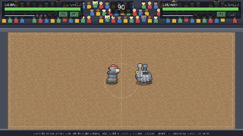

## Tests

```sh
godot --headless --path . --import
godot --headless --path . --script res://tests/run_tests.gd
```

221 tests cover every example combo, every Combo Trial, both Reaction Drills, Duel rules, every showcase, windups and counterplay,
rollback netcode (snapshots, two simulated machines over a laggy, lossy connection, online sessions over memory and real UDP: handshake, time sync, rematch, desync detection), every combo rule (variety bonus, stale moves,
hitstun decay, juggle cap, cancels on contact, stacks, energy, cooldowns, breakaway), grabs,
Slip counters, shockwaves, the Storm Drain pit ring, Barkley's pull, lob and root rings, Gillbert's reel and leap, Chef Cerebro's thrown kit (range, tenderizing, the flip, a volley of knives through a line), Hissy Fitz's poison, gaze and statues, Digby's blinding, tunnelling and rooting, Sneaky Pete's stealth, stolen power and blink, Sno Mercy's cone, syrup puddles and ice, terrain, determinism, replays, and the
CPU (reproducible matches, uses its whole kit, Hard beats Easy), and the mouse and gamepad
controls. A test that crashes counts as a failure. They run on every push via GitHub Actions.

## Art

Everything in `assets/sprites/` is **placeholder programmer art**: Cairn, the dummy, the
tiles and effects from `tools/gen_sprites.py`, and the fighters from the artist's sheets
(and Culvert) from posed 3D rigs (`tools/gen_*.py`). Sheet layouts are documented in [docs/SPRITES.md](docs/SPRITES.md);
replacement art with the same layout drops in without code changes.

## Audio

**TODO: all sound effects and music are placeholders**, synthesized by
`tools/gen_audio.py` so builds aren't silent. [docs/AUDIO.md](docs/AUDIO.md) is the
replacement checklist; which file plays for what, and how loud, lives in
`data/audio.json`, so replacements drop in without code changes.

## Roadmap

- [x] **Phase 0 – Prototype:** one creature vs. a dummy; move, dodge, attack, hitstop, knockback, breakable floor
- [x] **Combat system:** attack types, cancels, variety bonus, launches, counters, grabs, projectiles, Surges, breakaway
- [x] **Second fighter and CPU opponent:** Cairn, versus mode, best-of-3 rounds, Easy/Normal/Hard
- [x] **Effects pass:** per-move effects, knockout animations, Surge cut-ins, squash and stretch, combo tracker, crowd reactions
- [ ] **Vertical slice:** final art for two fighters, one finished arena, tag-team swap, local 2-player
- [ ] **Content:** eight creatures, five arenas, affinity surfaces
- [ ] **Polish and launch:** final music and SFX (placeholders in now, see docs/AUDIO.md), IP and name review, demo and store page

## Originality

Creature Arena is an original game. It uses no characters, names, art, sounds or trademarks
from any other franchise. There is no capture mechanic and no trainer character: you play as
the creature. Designs are checked against existing creatures for look-alikes (for example,
Cairn is a tall stack of stones rather than a round boulder with arms; Craglash's neck is
flat slab-like vertebrae rimmed in red, not a chain of round boulders).
