# Sprite sheet layouts

Use this as the spec for artists. If a replacement sheet keeps the same frame size and
row layout, it drops in with no code changes. If a layout does change, update the
`"sprite"` block in the creature's JSON file in `data/creatures/`; each move picks its
animation by name with its `"anim"` field.

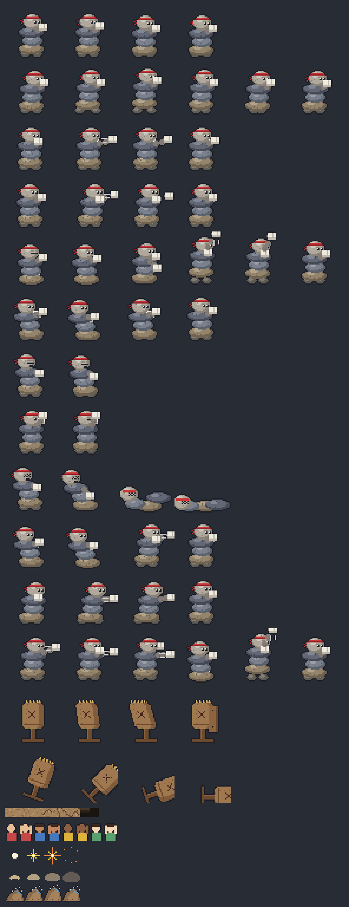

## Directions per creature: three sheets, five with the diagonals

Fighters face any of 8 ways, so every creature has **three sheets with the same rows**,
and have **two more for the diagonals** (every fighter but Cairn and the dummy, since the
Oct 2026 diagonal round):

| Sheet | Shows | Used when facing |
| --- | --- | --- |
| `name.png` | the side, facing **right** (mirrored for left) | left and right (and the diagonals, without the two sheets below) |
| `name_down_side.png` | a **front three-quarter** view, facing down-right (mirrored for down-left) | down-right and down-left |
| `name_down.png` | the **front**, walking toward the camera | down the screen |
| `name_up_side.png` | a **back three-quarter** view, facing up-right (mirrored for up-left) | up-right and up-left |
| `name_up.png` | the **back**, walking away from the camera | up the screen |

Which sheet: the facing's 360 degrees split into 8 sectors of 45, each centred on a
direction (`CreatureView.pick_view`), so a fighter facing exactly down-right uses
`down_side`. A fighter without the sheet a sector wants keeps the older rule: more up/down
than sideways (by 0.05) picks up/down, anything else the side sheet. Fighters with only
three sheets look exactly as they did.

In the up and down sheets, "forward" is depth: a punch that reaches 20 px in front of
the feet on the side sheet should land about 20 px below the feet (front view) or above
them (back view), because that's where the hit lands in the game. Arms and heads that
reach away from the camera go behind the body. The diagonals follow the same rule along
their diagonal: hits are circles on the floor, so a punch reaching 20 px lands about
14 px right and 14 px down the screen (`down_side`) or 14 px right and 14 px up
(`up_side`). The creature's right side goes the other diagonal (left and down in
`down_side`, right and down in `up_side`). `tools/splat3d.py` (`Cam`) projects them that
way, with the body's own depth flattened as in the down/up views (`depth_y`).

Each view can have its own frame size and feet origin (`"views"` in the creature's JSON
`"sprite"` block). Animations listed in `"side_only"` (all three use it for the knockout,
which falls over sideways) always come from the side sheet, so those rows can stay empty
in the others. Pete's five views side by side:
[`anim_preview/pete_diagonals_3x.png`](anim_preview/pete_diagonals_3x.png) and
[`pete_views_preview.png`](pete_views_preview.png); every other fighter has its own
`anim_preview/<id>_diagonals_3x.png` and `<id>_views_preview.png` (Craglash's diagonals:
[`craglash_diagonal_views_preview.png`](craglash_diagonal_views_preview.png)). Preview: [`sprite_views_preview.png`](sprite_views_preview.png) (Cairn,
side/down/up), [`culvert_views_preview.png`](culvert_views_preview.png), [`craglash_views_preview.png`](craglash_views_preview.png) and
[`barkley_views_preview.png`](barkley_views_preview.png) and
[`gillbert_views_preview.png`](gillbert_views_preview.png).

## Creatures — 48×48 frames, 6 columns

Creatures face **right**. Feet rest at the **origin** pixel (Cairn: x 22, y 43), which
sits on the ground where the shadow is drawn (the frame itself, as a silhouette laid along
the arena's light, so every opaque pixel casts). The game mirrors the
sprite to face left and raises it off its shadow when launched. Leave at least 1 px of
transparent margin on every side. Unused cells stay transparent.

Two effects read the art directly, so check them when sheets are replaced:

- **Cairn's knockout** slices idle frame 0 into horizontal bands, one per stone, and
  tumbles them separately. The band rows are `ko_fx.pieces` in `cairn.json` (head first),
  and `ko_fx.x_eyes` marks where the eyes are so they can be drawn as X's. If the final
  art moves the stones or the face, update those numbers.
- **Surge cut-ins** show one frame of the Surge animation enlarged, picked by
  `cut_in_frame` ([row, column]) in each creature's JSON.

How the game plays a move's frames: on 4-frame attacks, frame 0 is the windup, 1 the
strike, 2 the follow-through and 3 the recovery. Heavies use 6 frames: two charge frames
(alternating while held), rise, strike, follow-through and recovery. A move's `anim_at`
times its frames exactly instead, and `anim_charge` (`[first, count, ticks each]`) loops
more charge frames while held.

Idle and run play at one frame per 10 and 4 ticks. A sheet with longer cycles sets
`"idle_ticks"` and `"run_ticks"` in its `"sprite"` block (Crease: 8 frames at 8 ticks, 12
at 2, so his run cycle still takes 24 ticks and the stride keeps pace with his speed).

Footstep dust puffs on the run frames where a foot lands: `"step_frames"` in the sprite block
(default `[0, frames / 2]`: 6-frame runs `[0, 3]`, Crease's 12 `[0, 6]`). `"step": "slush"` makes a
creature's steps slush instead of the floor's dust (Sno Mercy); shallows always splash.

### Culvert — 96×96 frames, 12 × 14 (1152×1344 px)

Culvert is drawn by `tools/gen_culvert.py` with the shared splat renderer
(`tools/splat3d.py`), like the sheet recreations: a posed 3D rig projected into the
three views. He's a squat toad cast in storm-drain concrete: a wide, low body with a
lighter belly, a broad head with two bulging amber eyes (slit pupils) and a mouth the
width of his face that opens into a drain with iron bars across the lower jaw, a round
manhole cover on his back like a shell, big folded back legs with webbed feet (he hops to
get around), short front arms ending in concrete fists, moss in the cracks, and a throat
sac that pulses as he breathes. Concrete grain is a fleck pinned to his body (`decorate`,
hashed on body-local coordinates so it rides with him). Feet at **x 46, y 80**. Up and
down sheets (`culvert_down.png`, `culvert_up.png`) are 96×96, feet at x 48, y 80 (down)
and y 74 (up).

Animated with the roster pass (motion plan, previews and before/after GIFs:
[`anim_preview/culvert_motion_plan.md`](anim_preview/culvert_motion_plan.md)). Concrete
doesn't squash: `squash` stays 1 on every animated frame (asserted); the legs fold and the
body drops instead, and the weight is in the timing (slow up, fast down, held landings).
The overlap is the manhole cover (`cover_dy`, `cover_tilt`, `cover_lat`: it lifts, lands,
bounces and slides a frame late), the throat, the mouth and the spray. Legs are points
(`leg_pts`, `leg_ride`) so different leg poses tween; `foot` slides planted feet, `rise`
keeps the roll on the floor. `idle_ticks` 8 (a 64-tick idle), `run_ticks` 2 (the run
still 24 ticks), footsteps on `step_frames` `[2, 7]` (the push-off and the landing).

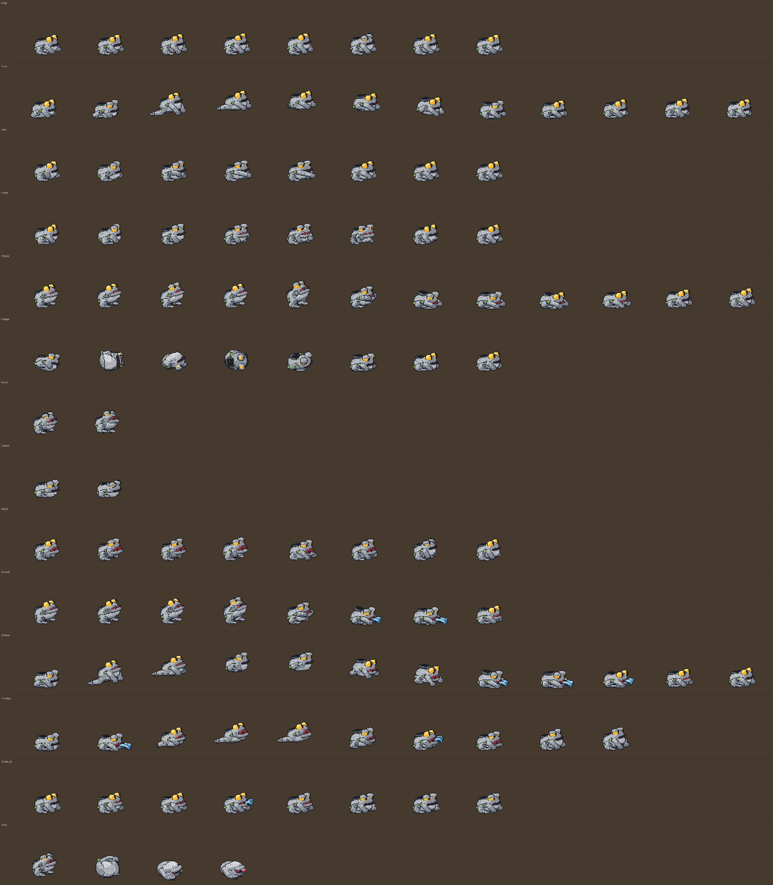

Facing down and up: [`culvert_views_preview.png`](culvert_views_preview.png).

The diagonals (`culvert_down_side.png`, `culvert_up_side.png`): 96×96 like the others
(no `"frame"` key), feet at x 48, y 80 (`down_side`) and y 74 (`up_side`), the plain
45-degree cameras with no cheat. Five views side by side:
[`anim_preview/culvert_diagonals_3x.png`](anim_preview/culvert_diagonals_3x.png).

| Row | Animation | Frames | Notes |
| --- | --- | --- | --- |
| 0 | idle | 8 | the breath, eased: the front of him rises, the throat fills 2 frames behind, a one-frame blink |
| 1 | run | 12 | the hop: crouch ×2 (feet and fists planted), spring (legs straight, the only stretch), sail ×3 (the cover lifting late), tuck, land as a drop (the cover still up), settle ×2 (the cover clanks down), rise; the body swings about 5 px around his shadow |
| 2 | jab | 8 | Jab (lights 1 and 2): turn and draw back, coil (held), one fast frame, extension held over the hit, further, snap back, settle, return |
| 3 | hook | 8 | Hook (light 3): wind, wind deep (held), the body turns a frame before the arm, whip, extension held, the fist past his face with the cover sliding, return, settle |
| 4 | heavy | 12 | Slam: 0–3 the charge loop (a heave, `anim_charge` `[0, 4, 5]`), the peak (held), one fast frame down, impact (held, the cover still up), the cover bounces, clanks down, a slow rise ×2, settle |
| 5 | dodge | 8 | the roll: a tuck, a full turn over his cover resting on the floor (4 frames), the thud (fists planted), settle, rise |
| 6 | hurt | 2 | recoil, mouth open; frame 1 doubles as the crumple pose |
| 7 | guard | 2 | hunkered low, fists up in front of his face |
| 8 | gulp | 8 | Gulp: 0–2 the charge loop (the drain yawning, the throat pumping, `anim_charge` `[0, 3, 5]`), rock back (held), the lunge mouth gaping (held while the game draws the tongue), the reel-in, the snap shut, the throat bulging |
| 9 | runoff | 8 | Runoff: 0–1 the charge (reared up), the rise, the peak (held), one fast frame down, the pound (held), the gush a frame later with the cover bouncing, a slow rise |
| 10 | storm | 12 | Storm Drain: the crouch (held), the push, the leap at full stretch (the cut-in frame, `[10, 2]`), tucked ×2, falling spread ×2, the slam (held, the cover still up), the cover bounce, a slow rise ×3; Manhole Drop has its own `anim_at` from frame 5 |
| 11 | victory | 10 | crouch (0), then a 7-frame croak-hop loop (frames 1-7: fists pumping, the drain gaping, spray off the thud), drops back onto his haunches (8) and sits smug, chin up, eyes narrowed (9, held) |
| 12 | idle_alt | 8 | the fidget (played once after a long stand): the throat swells into a bubble croak and pops, then a sideways eye toward the foe |
| 13 | ko | 4 | thrown back, tips over onto the cover, legs in the air, eyes crossed out; the game cracks him and gushes the water |

### Cairn — 6 × 12 (288×576 px)

| Row | Animation | Frames | Notes |
| --- | --- | --- | --- |
| 0 | idle | 4 | bouncing guard stance |
| 1 | run | 6 | loop |
| 2 | jab | 4 | lead hand: Jab, Jab |
| 3 | power | 4 | rear hand: Cross, Hook |
| 4 | heavy | 6 | Haymaker: charge A, charge B, dip, uppercut, follow-through, recover |
| 5 | dodge | 4 | weave: the stones slide sideways |
| 6 | hurt | 2 | hitstun; frame 1 doubles as the crumple pose |
| 7 | guard | 2 | fists up, blocking a hit |
| 8 | ko | 4 | stack topples and scatters; frames 1–2 double as the knockdown pose |
| 9 | slip | 4 | Slip: weave low, deeper, counter cross, recover |
| 10 | rush | 4 | Rockslide Rush: lean in, dash, punch, recover |
| 11 | surge | 6 | Avalanche: flurry A, B, C (cycled), wind up, uppercut, recover |

Design note for Cairn: keep it **tall and stacked**. A round boulder with two arms would
read as an existing franchise creature.

### Craglash — 96×96 frames, 12 × 16 (1152×1536 px)

Craglash is the first creature from the artist's character sheets. His sheet is a
pixel recreation of that sheet made by `tools/gen_craglash.py`, a small puppet rig
(torso, legs, arms, segmented neck, maned head) posed frame by frame, with the palette
sampled from the artwork. Every part is cel-shaded from its own distance field (a lit
rim on the top left, a two-tone shadow on the bottom right, a flat base between), then
outlined, so limbs read as round at the game's zoom. What makes him Craglash, all taken
from the sheet: the crown of five spikes around the neck base and the spines on his
flanks, the pale stone veins across his chest and forearms with two small blue gems, the
lighter furred belly and the shaggy band at his hips, three-clawed mitten hands and
three-toed feet, elbow spikes and knee tufts, a neck of flat grey slabs rimmed in dark
red (thicker at the base), and a big two-layer bristling mane round a face with yellow
eyes under heavy brows, a snout and a wide red grin. The mane flares on hits and lies
flat on windups (`mane` in a pose). Big frames because the neck reaches far: the head is
50 px in front of the feet on Boulder Lash and 89 px above them at the top of Avalanche
Coil; standing, his mane tops out 71 px above his feet (`fx_top`). Feet at **x 34, y 90**.
Any creature can use a bigger frame by setting `"frame"` in its JSON; the game, the
cut-in and the team select scale to it. His up and down sheets (`craglash_down.png`,
`craglash_up.png`) are **128×160** frames with the same rows minus the knockout, feet at
x 64, y 112 (down) and y 124 (up); the same rig draws them from the front and from behind.

His diagonal sheets (`craglash_down_side.png`, `craglash_up_side.png`, the same 128×160
frames and rows, feet at x 64, y 112 and y 124) come from a third rig, `DRig`, a
three-quarter blend of the side puppet and the up/down `VRig`. It keeps the VRig's 3D
reading of each side pose (feet, hands, neck bends and head as sideways, up and forward,
with the same foreshortening of the feet and the head's reach) and turns the floor 45
degrees: forward lands 0.707 right and 0.707 down (`down_side`) or up (`up_side`), so the
Maw's head lands on the hit as in the other views, and the sideways axis runs the other
diagonal with its height flattened (`LAT_Y` 0.3) so the shoulders don't slant. The side
the side sheet shows nearest (arm and leg 1) is toward the camera in both. The torso,
crown and flank spines are drawn square to the camera (a round body is about as wide
from any angle) with the belly slid toward forward (`down_side`) or the spine's stone
ridge toward backward (`up_side`); the legs bend their knees forward in their own plane;
a hand reaching forward closes in on the middle line, so a Rake sweeps across the chest
along the diagonal; the far arm and leg are darkened as on the side sheet. Parts sort by
depth: the near arm in front of the torso, the far one behind unless it swings across
(`arm0_front`) or reaches toward the camera; the neck bows behind the head (the VRig bows
it out to the side for the front view). The head has three-quarter faces: `_face_quarter`
(both eyes, the far one narrower, the snout and mouth slid down-right) and, from behind,
parted fur with the near eye's corner and the snout's edge at the cheek; it sits on the
neck's top stones in `up_side` so the mane reads.

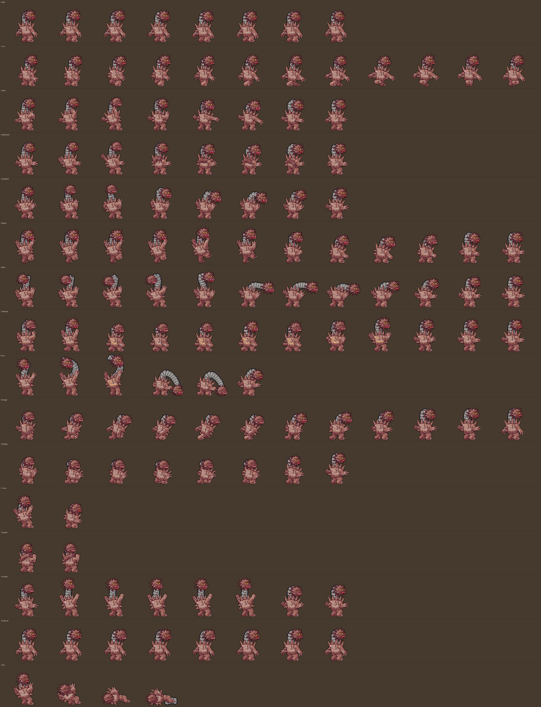

Animated with the roster pass (motion plan, previews and before/after GIFs:
[`anim_preview/craglash_motion_plan.md`](anim_preview/craglash_motion_plan.md)): stone, so
no squash (`sy` stays 1); weight is timing (slow lift, one fast frame, held landings) and
the neck, head, mane and arms lag the body. `idle_ticks` 8 (a 64-tick idle), `run_ticks` 2
(the run still 24 ticks), every move on an `anim_at`, the heavy's charge loop `[0, 4, 6]`.

| Row | Animation | Frames | Notes |
| --- | --- | --- | --- |
| 0 | idle | 8 | breath on eased spacing; head, neck and mane sway late |
| 1 | run | 12 | stomp walk: planted foot slides back evenly, slow lift, fast plant; the stomp travels up the neck |
| 2 | claw | 8 | Rake (light 1): coil held, snap, hit held, claw drags |
| 3 | backhand | 8 | Backhand (light 2): the far arm cocks back, whips across the body |
| 4 | headbutt | 8 | Headbutt (light 3) and Landslide Entry (own `anim_at`): the head launches ahead of its neck |
| 5 | stomp | 12 | Rockslide Stomp: 0-3 the charge loop (foot lifted, trembling), top of the lift, drop, held impact, overshoot, slow rise |
| 6 | lash | 12 | Mountain Maw: the neck coils back, snaps out, shivers while the head flies, reels in |
| 7 | bedrock | 12 | Bedrock: wide stance, fists down, sunk in, a 4-frame pulse loop (3-6) while rooted, release roar |
| 8 | coil | 6 | Avalanche Coil: only the Surge's cut-in picture now (`cut_in_frame` `[8, 2]`) |
| 9 | charge | 12 | Landslide Charge: crouch, drive, a 4-frame head-low run (2-5), brake, skid, settle |
| 10 | dodge | 8 | dip, tuck behind the spikes (invulnerable frames 1-4), skid, uncurl |
| 11 | hurt | 2 | recoil; frame 1 doubles as the crumple pose |
| 12 | guard | 2 | forearms crossed, head tucked behind them |
| 13 | victory | 8 | a slow mountain roar: breathe in and rear back, 1-5 loop (head high, fists up, mane bristling, a pixel of hip shudder to shake the stones), 6-7 breathe out and hold |
| 14 | idle_alt | 8 | grinds his jaw (angry and strain faces), the head turns slowly toward the foe and back, the mane bristles once |
| 15 | ko | 4 | stagger, topple, down, neck stones scattered|

When the artist's final Craglash arrives, either keep this layout (then it drops in), or
change the `"sprite"` block in `data/creatures/craglash.json` to match theirs. Design
note: keep the neck as flat slabs rimmed in red rather than round grey boulders, so it
doesn't read as a chain of boulders from an existing franchise.

### Barkley — 96×96 frames, 12 × 15 (1152×1440 px)

Barkley is the second creature from the artist's sheets. `tools/gen_barkley.py`
recreates him as a small **3D puppet** (a trunk that forks into two leg-trunks with
splayed roots, two long branch arms with twig fingers and leaf sprouts, a face with
small blue eyes and a long nose, a moss beard, and the log across his head with its
rings on the cut end), posed once and projected into all three sheets. That keeps the
views in step, including Timber Twister, where the whole tree turns on its roots. The
side sheet is a cheated 3/4 view: forward is drawn one to one so reach on screen
matches reach in the simulation, while his sideways span is turned toward the camera
so the arms and the log across his head still read. Feet at **x 40, y 90**. Up and down
sheets (`barkley_down.png`, `barkley_up.png`) are **128×160** with the same rows minus
the knockout, feet at x 64, y 112 (down) and y 124 (up). Twelve columns for the
roster animation pass; `"select_scale"` in the sprite block shrinks his portrait on the
team select (the log makes him tall for his frame).

Animated with the roster pass (motion plan, previews and before/after GIFs:
[`anim_preview/barkley_motion_plan.md`](anim_preview/barkley_motion_plan.md)). He is wood,
so the trunk never squashes: weight is timing (slow rises, fast falls, long holds) and
overlap (the boughs and their elbows 2 frames behind the trunk, `twig` the arm twigs,
`leaf` the log's leaf, the log landing a frame after the trunk). `idle_ticks` 10 (an 80-tick
idle, the slowest), `run_ticks` 2 (the run still 24 ticks), footsteps on the default
`[0, 6]` (the two hard plants).

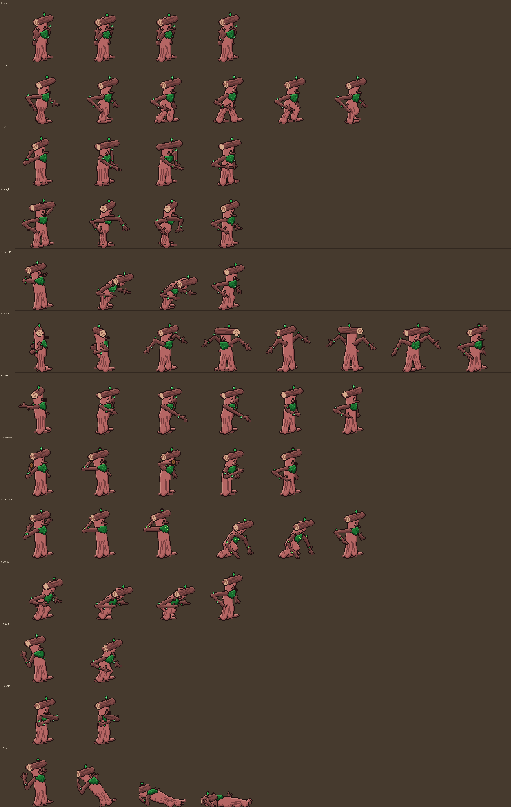

Facing down and up, and the diagonals: [`barkley_views_preview.png`](barkley_views_preview.png).
The diagonal sheets (`barkley_down_side.png`, `barkley_up_side.png`, **128×160** like the up
and down sheets, feet at x 64, y 112 and y 124) come from two more projections in his `Cam`,
the same floor rule as splat3d's: reach goes 0.707 right and 0.707 down (or up), his body's
own depth flattened by `depth_y`. Everything else (the ring end of the log, which eye and
side of the nose show, which arm is in front) follows from the camera direction, so the
painter needed no per-view cases. All five views at 3x:
[`anim_preview/barkley_diagonals_3x.png`](anim_preview/barkley_diagonals_3x.png).

| Row | Animation | Frames | Notes |
| --- | --- | --- | --- |
| 0 | idle | 8 | the sheet's pose (one arm low, one raised in a curl), a slow eased sway; the raised bough 2 frames behind, the log's leaf 3, one slow blink |
| 1 | run | 12 | the lumber: per step a hard plant, the trunk settling over it for 2, a slow rise, a slow root lift, a fast swing through; the planted foot slides back evenly; boughs 2 frames behind, bending at the top of the swing |
| 2 | twig | 8 | Twig Swipe (light 1): weight back, coil, one fast frame, the hit (held 3), the bough carries on, twigs overshoot, settle |
| 3 | bough | 8 | Bough Swing (light 2): the Twig Swipe from his other side with a deeper coil and a wider arc |
| 4 | logdrop | 8 | Log Drop (light 3) and Timber Drop: rear back, a held peak, the tip, the log lands (a frame after the trunk), a long hold, a slow rise |
| 5 | twister | 12 | Timber Twister: 0–1 the charge crank (`anim_charge` `[0, 2, 6]`, frame 1 the windup), 2–9 an 8-frame spin at 45° a frame (boughs trailing), 10 the unwind, 11 the settle |
| 6 | grab | 12 | Branch Grab: cocked arm (held through the windup), coil, three fast launch frames, open reach, claw closed (held), the reel, settle |
| 7 | pinecone | 12 | Pinecone Bomb: 0–3 the charge loop (`anim_charge` `[0, 4, 6]`, cone overhead, arm trembling), pull back, throw, the release (frame 7, the cone leaves at tick 10), follow-through, recover |
| 8 | eruption | 12 | Root Eruption: a four-frame gather (arms up, leaves glowing; frame 3 is the cut-in, `[8, 3]`), the plunge, the strike held over the first ring, ring 2 recoil, ring 3 boughs flung up, settle |
| 9 | dodge | 8 | bow low under the swing: gather, the bow (held), two lurching steps, rise; on its own `dodge.anim_at` timeline (a view-only key) |
| 10 | hurt | 2 | recoil; frame 1 doubles as the crumple pose |
| 11 | guard | 2 | branch arms crossed in front |
| 12 | victory | 8 | arms thrown up like boughs, trunk stretched tall; frame 0 gathers, 1-5 loop (boughs sway, leaf and twigs rustling a beat behind), 6-7 hold the proud stance (no bird prop) |
| 13 | idle_alt | 8 | a creak: trunk leans and turns toward the foe, an arm shakes a leaf loose, straightens (played once after a long stand) |
| 14 | ko | 4 | stagger, then topples over backward like a felled tree, roots torn up |

Moves time their frames with `"anim_at"` (`[[tick, frame], ...]` in the move's JSON),
so the spin and the lob play exactly in step with the hits. Design note: the log across
the head, the moss beard and the root feet are what make him read as Barkley; a round
tree body with leafy hands would drift toward existing franchise creatures.

### Gillbert — 128×128 frames, 16 × 15 (2048×1920 px)

Gillbert is the third creature from the artist's sheets. `tools/gen_gillbert.py` builds
him on Barkley's 3D approach: a fish body as a tube along a bendable spine (curl, arch,
side-to-side wiggle, roll onto his side), the red-and-white life ring split into the
half behind him and the half in front, fins, barbels, an orange eye on each side, the
line tangled round his body, and the **rod as its own rigid piece** with a position and
spin in every pose. A pose that tips his nose up lifts him so the tail stays on the floor.
He always wears the ring, and it is much bigger than he is thick (it shows above his back and
below his belly). Side-on its far half goes behind his body and its near half crosses in front,
kept wide enough to read however he turns; head-on or from behind he is split at the ring, so
the end nearer the camera is drawn over it and the far end under it. Feet (belly) at **x 70, y 112**; big frames because the rod flies out in front on Cast Line
and tumbles far behind on the run. Up and down sheets (`gillbert_down.png`,
`gillbert_up.png`) are **96×144**, feet at x 48, y 92 (down) and y 76 (up).

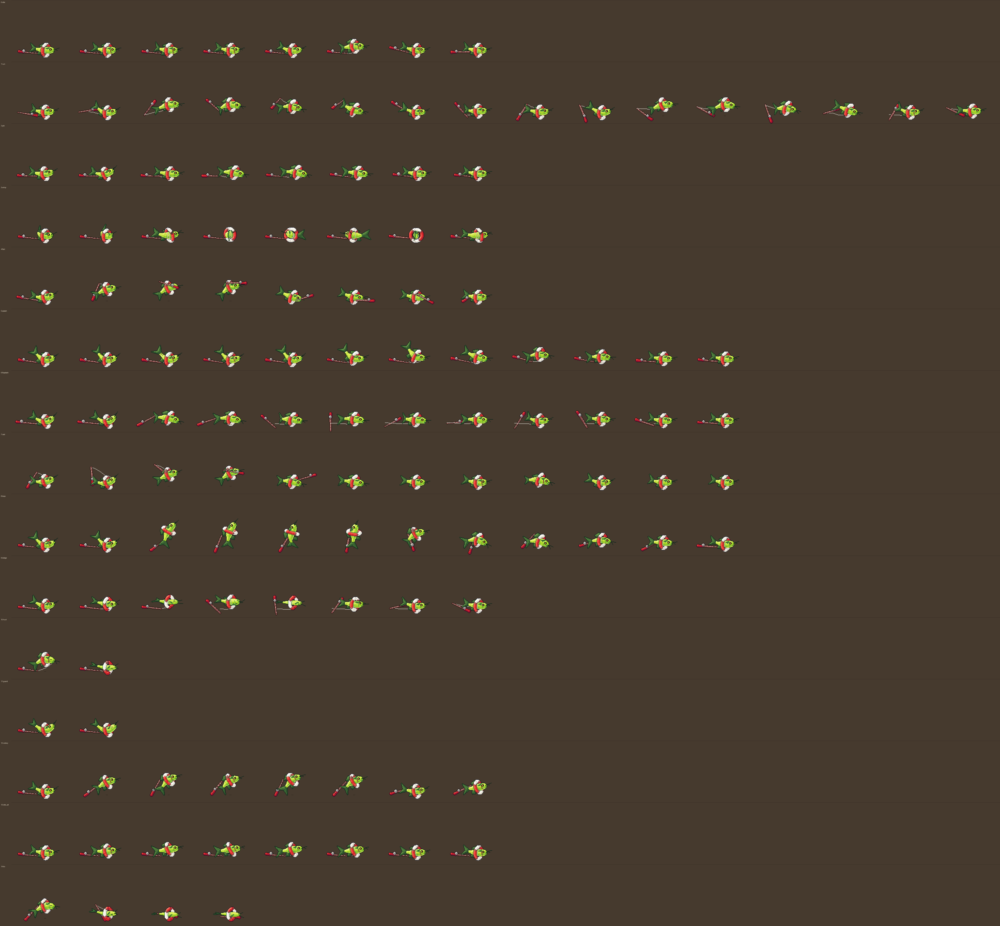

Animated with the roster pass (motion plan, previews and before/after GIFs:
[`anim_preview/gillbert_motion_plan.md`](anim_preview/gillbert_motion_plan.md)): every
ability redrawn, the tail fin, the fins and the rod each on their own lag (`tail_lag`,
`fin_lag`, `drag_rod`), the line kinking (`Pose.kink`), squash and stretch capped at 12%.
`idle_ticks` 8 (a 64-tick idle), `run_ticks` 2 (the run still 32 ticks), `step_frames`
`[6, 14]` (the slaps); the sheet is 16 columns wide for the 16-frame run.

Facing down and up, and the diagonals: [`gillbert_views_preview.png`](gillbert_views_preview.png).
The run in side, front and back: [`gillbert_run.gif`](gillbert_run.gif). The diagonal sheets
(`gillbert_down_side.png`, `gillbert_up_side.png`, **128×144**, 16 columns like the others,
feet at x 72, y 100 facing down-side and x 64, y 84 facing up-side, off centre because the
rod trails up-left or down-left) come from two more projections in his `Cam` (splat3d's floor
rule, with his long `depth_y` flattening). The painter's one new case is the ring: he passes
through it at a slant, so its far half goes behind all of him, its near half over his flank,
and the end of him nearer the camera (head facing down-side, tail facing up-side) over that.
All five views at 3x: [`anim_preview/gillbert_diagonals_3x.png`](anim_preview/gillbert_diagonals_3x.png).

| Row | Animation | Frames | Notes |
| --- | --- | --- | --- |
| 0 | idle | 8 | lying on his belly: four frames of gills working (eased) with the tail a frame behind, a gather, one fast twitch hop, a squashed landing, a settle; the rod settles 2 frames after the hop |
| 1 | run | 16 | two flops a cycle, a big one and a small one the other way: curl, coil (held), spring, rise, apex, nose down, slap (frames 6 and 14), bounce. The rod is erratic: spin speed changes every frame, the line kinks and straightens, it clatters on the floor 2 and 4 frames after the slaps |
| 2 | jab | 8 | Snout Jab (light 1): spine bent back (held 2), snap, extension (the hit frame), overshoot, back |
| 3 | whip | 8 | Tail Whip (light 2): wind the other way, a half turn on the belly, the tail trailing by 2 frames and overshooting |
| 4 | flail | 8 | Rod Flail (light 3): head jerk, the rod up over him on a kinking line, a held top, the strike, a bounce off the floor, settle |
| 5 | splash | 12 | Splash Zone: 0-3 the charge loop (`anim_charge` `[0, 4, 3]`), deepest coil, rise, tail high, fall, slap (frame 8, squash 12%), rebound, settle, recover |
| 6 | flopdash | 12 | Flop Dash: crouch (held through the windup), load, stretched launch, belly skid snaking side to side, stop in a flop, bounce, settle; the rod streams behind and catches up last |
| 7 | cast | 12 | Cast Line: head and rod back, coil, the rod up and over, released (frame 4), follow-through without the rod, recover; 8 is the reel yank (`anim_reel`), 9-11 the stumble after it |
| 8 | leap | 12 | The One That Got Away: crouch, load, stretched launch, rising and shrinking, apex, tip over, falling spread out, belly flop (frame 9, held 5), bounce, the rod lands last; Splashdown (tag-in) plays frames 6-11 from its own `anim_at`; `"view_lift"` raises him off the screen; `cut_in_frame` `[8, 4]` |
| 9 | dodge | 8 | a sideways tumble in a hop, five eased steps of roll, a squashed landing |
| 10 | hurt | 2 | recoil; frame 1 (on his side) doubles as the crumple pose |
| 11 | guard | 2 | curled up behind the life ring |
| 12 | victory | 8 | rears up proud, the rod held high and the line swinging; frame 0 gathers, 1-5 loop (flop in place, gills flaring), 6-7 settle into the held pose |
| 13 | idle_alt | 8 | a gasp: gills flare and flutter, head up and turned toward the foe, settle (played once after a long stand) |
| 14 | ko | 4 | a last flop, then on his side with the rod across him |

Design note: the life ring, the barbels and the rod on its line are what make him read as
Gillbert, not as a fish from an existing franchise.

### Chef Cerebro — 128×128 frames, 12 × 15 (1536×1920 px)

Chef Cerebro is the fourth creature from the artist's sheets, reworked as a **floating
brain who fights by telekinesis**. `tools/gen_cerebro.py` uses the same cameras as Barkley
and Gillbert, but renders differently: every piece is sampled as 3D points (the brain as
ten overlapping lobe ellipsoids, the brainstem as a tube, the blades and spatula head as
flat plates, the mallet head as a box) and splatted into a depth buffer. The buffers are
then shaded and outlined by `splat3d`'s pass on master-palette ramps (`splat3d.shade` /
`outline`, see "Palette"): a hard terminator, a low-contrast core shadow, a rim light,
seams between pieces in the deep step (which draws the lines between the lobes, as on the
sheet; `SOFT_SEAM` is 0 here so every lobe seam gets the deep step), and decorated in the
brain's own coordinates: the black half-moon sunglasses (turned out to the sides, so they
read from the side and the front), their bridge and arms, and a few wrinkle strokes on
each lobe (the wine line). The brain is the `salmon` ramp (the peach line) capped at its light step (no
near-white highlight on a dozen lobes), outlined in its ink (plum, the palette's take on
the sheet's maroon); the tools (`concrete` steel, `ink` handles, `blue` spatula, `rust`
mallet) are outlined in black (`outline_mats`). No line where the stem grows out of the
brain. Before and after: [`palette/cerebro_before_after_3x.png`](palette/cerebro_before_after_3x.png),
[`palette/ingame_cerebro.png`](palette/ingame_cerebro.png).

He hovers about 11 px off the floor (`HOVER`), a short brainstem dangling under him, with
no limbs: his kit floats in a loose ring, each piece bobbing on its own (`REST` and
`PHASE` in the generator): the big chef's knife out front, the navy spatula behind, the
meat mallet above his back and three paring knives fanned over his brow. Floating tools
get a faint violet halo; the one he's working with (`active` in a pose) a bright,
two-pixel one, and his brain flushes violet as he pushes (`psy`: from 0.5 its shadows
turn violet, from 0.85 the whole brain but its light, `FLUSH_HALF` / `FLUSH_FULL`, palette
colours swapped one for one rather than blended). A thrown tool is simply
missing from the frame (the game draws it in flight, also in violet). Tools are posed in
character space, not on the brain, so they drift on their own as he bobs. Feet (the
floor under him) at **x 62, y 100**. The rig is modelled large and drawn at 0.72 scale
(`SCALE`). Up and down sheets (`cerebro_down.png`, `cerebro_up.png`) are **112×128**,
feet at x 56, y 88 (down) and y 76 (up). The diagonals (`cerebro_down_side.png`,
`cerebro_up_side.png`) are **128×128**, feet at x 64, y 88 (down-side) and y 76 (up-side),
projected by the generator's own copy of `splat3d.Cam`'s diagonal cameras; no per-view
cheats (his props are posed in character space, so they fall where the 3D layout puts
them: at rest the spatula, behind-right of him, hangs in front of the brain in `up_side`).
All five views: [`anim_preview/cerebro_diagonals_3x.png`](anim_preview/cerebro_diagonals_3x.png).

Animated with the roster pass (motion plan, previews and before/after GIFs:
[`anim_preview/cerebro_motion_plan.md`](anim_preview/cerebro_motion_plan.md)): every tool
in the kit follows the brain on its own lag (1 to 3 frames, the mallet latest), the brain
squashes up to 10% and wobbles back over 2 frames (jelly), throws are draw-back (held),
one fast frame with a violet speed streak (`smear`), and a held release with the brain
pitched after the tool; the blink has a `flash`. `idle_ticks` 8 (64 ticks), `run_ticks` 2
(24 ticks), no footstep dust (`step_frames` `[]`: he floats). Mind Blink plays on the
dodge block's `anim_at`, drawn at full strength on its flash ticks (`blink.solid`).

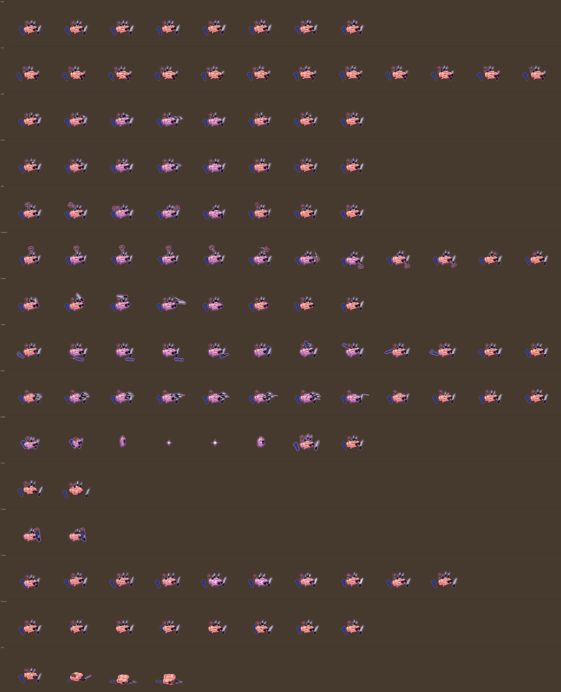

Facing down, down-side, up and up-side: [`cerebro_views_preview.png`](cerebro_views_preview.png).

| Row | Animation | Frames | Notes |
| --- | --- | --- | --- |
| 0 | idle | 8 | floating, an eased bob; each tool riding it 1-3 frames late on its own small orbit, the stem 2 frames behind, a glint across the sunglasses on the top frame |
| 1 | run | 12 | gliding: leaning in, stretched along the way (to 10%), one gentle bob; the stem 3 frames behind, the kit trailing and catching up (the mallet latest), the flush pulsing |
| 2 | flick | 8 | Knife Flick (light 1): the knife swings round over his brow, aims, draws back (held), the throw with a streak, gone (held, the brain pitched after it), wobble, a fresh knife rising, settle |
| 3 | flick2 | 8 | Backhand Flick (light 2): the same from his other side |
| 4 | toss | 8 | Mallet Toss (light 3): lift, wheel back, coil (held), the fling with a streak, gone (held 5), wobble, the mallet floating home |
| 5 | tenderize | 12 | Tenderize: 0-3 the charge loop (`anim_charge` `[0, 4, 6]`, the mallet trembling overhead), the peak, over the top, coming down, the pound (held, 10% squash), wobble, wobble, lifting off, home; Order Up has its own `anim_at` from frame 5 |
| 6 | cleaver | 8 | Cleaver Toss: rise, wheel back, coil above the paring knives (held), the snap with a streak, gone (held), wobble, settle, back at his side |
| 7 | flipout | 12 | Flip Out: swung back low (held through the windup), dive, skim, the scoop (held over the grab), lift, a big arc over his head, the flip behind him, overshoot, home |
| 8 | flurry | 12 | Knife Flurry: the fan gathers, aims, draws back (held, the cut-in frame `[8, 2]`), a 4-frame throw loop (one frame per knife: the slot empty with a streak, the next knife drawn back, the brain pitching and rolling), the last knife (held), wobble, the knives home |
| 9 | dodge | 8 | Mind Blink: squashed wide with the kit folding in, stretched thin, a needle, a point in a flash, the flash at the new spot, back stretched, a wobble with the kit flung out, settle. The dodge's `anim_at` times them; `CreatureView` fades him out and back in, but not on the flash ticks |
| 10 | hurt | 2 | reeling, sunglasses knocked askew, his grip on the kit slipping; frame 1 doubles as the crumple pose |
| 11 | guard | 2 | the cleaver, spatula and mallet swing in front of him into a wall |
| 12 | victory | 10 | gathers (0), then a 7-frame chef's-kiss loop (1-7: tipped forward in the kiss with a violet sparkle at his middle, the kit orbiting, glasses glinting), the finish tips back (8) and the kit hangs in a proud arc (9, held) |
| 13 | idle_alt | 8 | the fidget: the spatula taps his brow twice (the thinking tap), then the kit stirs and his gaze goes to the foe, glasses glint |
| 14 | ko | 4 | his mind lets go: the kit falls, clatters to the floor, the brain sinks after it and deflates, sunglasses off |

Design note: the sunglasses and the kitchen floating around a brain are what make him
read as Chef Cerebro. Name check before release: "Cerebro" is also the name of a
well-known comic-book device (see the PR notes).

### Hissy Fitz — 128×128 frames, 12 × 15 (1536×1920 px)

Hissy Fitz is the fifth creature from the artist's sheets. `tools/gen_hissy.py` renders
like Chef Cerebro's generator (3D points splatted into a depth buffer, then `splat3d`'s
ramp shading and outlines on master-palette ramps), with a black silhouette line as on the
sheet (every material's ink set to black) and seams in each material's deep step. Skin
(the `peach` ramp), snakes (the green line's dark end) and spots (`gold`) light only
in the highlight (`_matte`: the light step is the base), so the skin doesn't go white and
the snakes stay the sheet's deep green; the gloves are `red`, also matte, the cuffs a step
darker, the earrings `violet` a step lighter. The face texture's colours are palette steps
(`FACE`), and on the head's shadow side each is the step below on its line. Before and
after: [`palette/hissy_before_after_3x.png`](palette/hissy_before_after_3x.png),
[`palette/ingame_hissy.png`](palette/ingame_hissy.png). The
rig: a big round head floating over the floor (she never touches it: the gloves stay up
in a guard under her chin, `NEAR_REST`/`FAR_REST`, everywhere but the knockout), nine spotted green hair snakes (each a
wavy tapered tube ending in a little head with eyes and a forked red tongue) fanned out
in a sunburst, two purple crystal earrings, and two more snakes from under her chin down
to the red boxing gloves. The face (big yellow slit eyes with blue eyeshadow and lashes,
a cocked brow, the lopsided zigzag grin) is painted once into a texture in the head's own
azimuth and elevation, so it wraps the round head in every view; in the side view her
head is turned a little toward the camera (`SIDE_CHEAT`), so both eyes and the grin read.
Expressions: grin, shout, gaze (glowing eyes), hurt, ko.

Feet at **x 64, y 104**, drawn at 0.72 scale. Up and down sheets (`hissy_down.png`,
`hissy_up.png`) are **112×128**, feet at x 56, y 104 (down) and y 92 (up). The diagonals
(`hissy_down_side.png`, `hissy_up_side.png`) are **128×128**, feet at x 64, y 104 and
y 92, projected by the generator's own copy of `splat3d.Cam`'s diagonal cameras. Facing
down-right her head turns a further 18 degrees toward the camera (`CHEAT["down_side"]`,
like `SIDE_CHEAT`) so the far eye and the grin don't crowd the edge; facing up-right
shows the back of her head as the up view does (no cheat). In both diagonals the
earring crystals face the camera. All five views:
[`anim_preview/hissy_diagonals_3x.png`](anim_preview/hissy_diagonals_3x.png).

Animated with the roster pass (motion plan, previews and before/after GIFs:
[`anim_preview/hissy_motion_plan.md`](anim_preview/hissy_motion_plan.md)): nothing on her
moves at the same time as anything else. Poses are in-betweened with `splat3d.tween`
(gloves on arcs); `sq` squashes the head up to 10%; the hair sways as a wave travelling
down each snake (`wave`, `sway`, `tip_lag`) and is thrown tips last (`lash_tip`,
`rear_tip`, `raise_tip`); the glove snakes trail their gloves (`trail_arms` sets
`near_bow` / `far_bow`), which is the whip. `idle_ticks` 8 (64 ticks), `run_ticks` 2 (the
glide still 24 ticks).

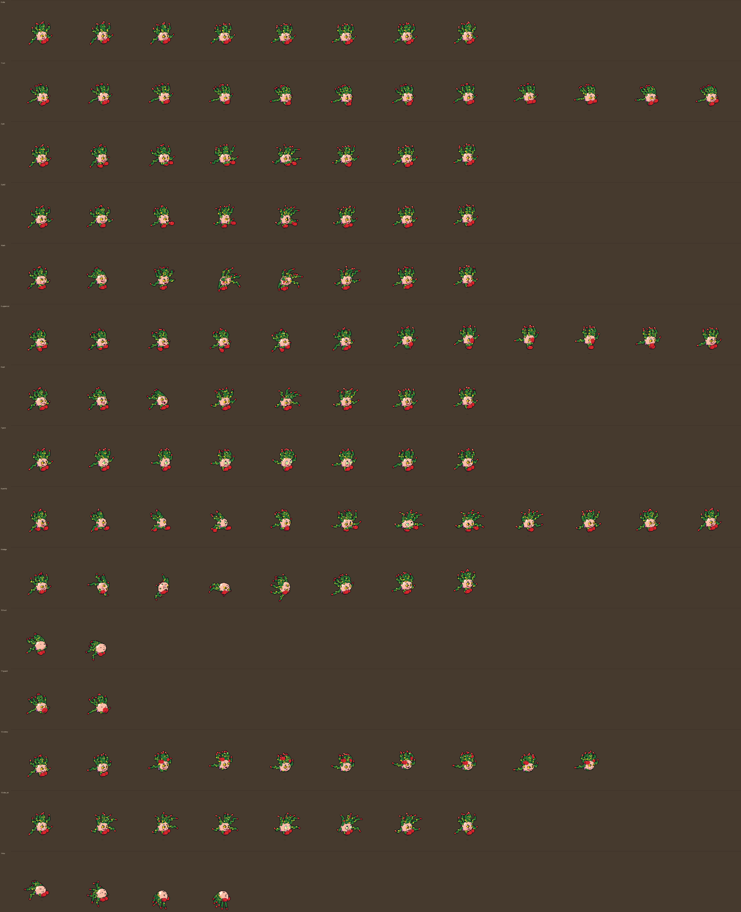

Facing down, down-side, up and up-side: [`hissy_views_preview.png`](hissy_views_preview.png).

| Row | Animation | Frames | Notes |
| --- | --- | --- | --- |
| 0 | idle | 8 | the hover bob (eased), the gloves 1 frame behind, the glove snakes after them, the hair swaying as a wave down each snake (tips 2 frames behind) |
| 1 | run | 12 | the glide: head leading and tipped in, a gentle double bob, the gloves weaving figure-8s 1 frame behind, the hair streaming back 3 frames late |
| 2 | jab | 8 | Snake Jab (light 1): dip, coil (held), snap (the snake still bent behind the glove), extension held over the hit (the snake straight), overshoot, snap back, settle, return |
| 3 | jab2 | 8 | Snake Jab (light 2): the same whip with the far glove crossing in |
| 4 | lash | 8 | Hair Lash (light 3): duck, hair pulled back (held), the bases swing forward, the tips whip through on the hit (held), overshoot, ripple, settle, return |
| 5 | uppercut | 12 | Coil Uppercut: 0–3 the charge loop (`anim_charge` `[0, 4, 4]`, the glove cranking round low with the snake winding after it), deepest coil, burst, rise, the uppercut held over the hit, overshoot, hang, drop, settle; Hiss Off has its own `anim_at` from frame 5 |
| 6 | spit | 8 | Venom Spit: rear, rear deep (held), snap forward bases first, spit held 4 ticks (a venom glob at their mouths), recoil, settle, return; the game draws the glob in flight |
| 7 | gaze | 8 | Stone Gaze: lean in, the hood rising; 2–5 the stare loop timed to the 10-tick pulses (2 and 4 flare and sweep left, right; the hood ripples); the hood drops, settle |
| 8 | petrify | 12 | Petrify Punch: a 4-frame gather (frame 3, held, is the stare and the cut-in frame, `[8, 3]`), the punch in one frame, impact held 5, shockwave held 4, follow-through, pull back, recover, hair settling, settle |
| 9 | dodge | 8 | duck, a full roll (the hair whipping round), land squashed, pop up |
| 10 | hurt | 2 | recoil; frame 1 doubles as the crumple pose (frame 0 is the petrified statue's pose, tinted grey by `CreatureView`) |
| 11 | guard | 2 | gloves up in front of her face, snakes pulled in |
| 12 | victory | 10 | crouch (0), then a 7-frame boxer's bounce loop (1-7: gloves punching the air in turn, hair fanned like a hood, hissing), settle (8), both gloves high (9, held) |
| 13 | idle_alt | 8 | the fidget: the snakes squabble, lunging and hissing out of step, then all stare at the foe, hair thrown forward, and she relaxes |
| 14 | ko | 4 | the head drops onto the gloves and tips over, hair limp, tongue out |

Design note: she must not read as Medusa from mythology-themed games or films: the boxing
gloves, the floating head, the earrings and the cartoon grin carry her look. Snakes for
hair is a myth motif anyone can use; the name and gloves are hers.

### Digby — 128×128 frames, 12 × 15 (1536×1920 px)

Digby is the sixth creature from the artist's sheets, and the first generator on the
shared renderer, `tools/splat3d.py` (the splat renderer Chef Cerebro and Hissy Fitz use,
pulled out into one module): `tools/gen_digby.py` holds only his palette, rig and poses,
and `python3 tools/gen_digby.py inspect idle:0 run:2` renders a few frames in all three
views for working on a pose. The rig: a long, low mole on all fours, the body pivoting at
the hips so he can rear up for swipes; a long snout with a purple nose and whiskers; an
orange miner's helmet with a white band and a yellow headlamp (a white glow when it
flashes); yellow claws on every paw; a huge bushy tail; a grey pickaxe in the near front
paw. Burrowing sinks the rig into the floor (everything below it is cut away) under a
dirt mound. Drawn at 0.8 scale, feet at **x 64, y 100**; up and down sheets are
**112×128**, feet at x 56, y 100 (down) and y 90 (up).

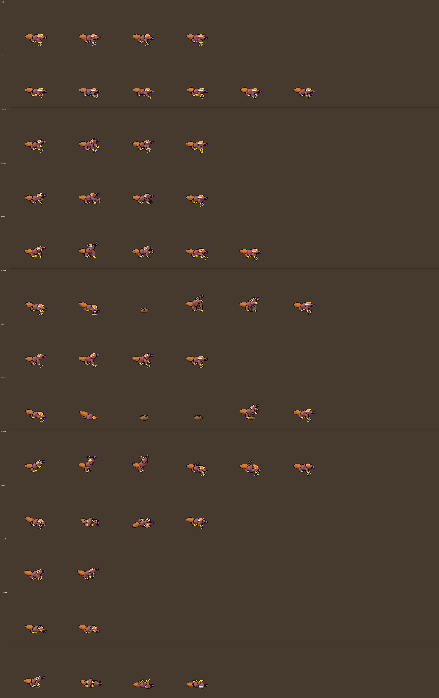

Facing down and up: [`digby_views_preview.png`](digby_views_preview.png).

The diagonals (`digby_down_side.png`, `digby_up_side.png`): **128×128** (as wide as the
side sheet, for the snout-to-tail length on the diagonal), feet at x 64, y 100
(`down_side`) and y 90 (`up_side`), no cheat; the headlamp and pick are 3D parts of the rig,
so they sit where each camera sees them. Five views side by side:
[`anim_preview/digby_diagonals_3x.png`](anim_preview/digby_diagonals_3x.png).

Every ability had the roster animation pass (Oct 2026): the motion plan with every
`anim_at` is [`anim_preview/digby_motion_plan.md`](anim_preview/digby_motion_plan.md), and
`python3 tools/gen_digby.py anim` renders the before/after previews. The idle is 8 frames
at `idle_ticks` 8 (64 ticks), the gallop 12 at `run_ticks` 2 (24 ticks, unchanged), with
dust on `step_frames` `[0, 2]` (the front paws landing, the back paws landing).

| Row | Animation | Frames | Notes |
| --- | --- | --- | --- |
| 0 | idle | 8 | sniffing: two quick sniffs, a held look toward the camera, eased breath; the helmet and tail lag |
| 1 | run | 12 | a gallop: front paws land (0, 1), back paws 2 frames later (2, 3), the gather (3-5), push-off, a suspension (9-11), the reach |
| 2 | swipe | 8 | Claw Swipe (light 1): anticipation, rear-up with the far claw cocked over the helmet (held), the slash, the release (held, the hit), follow-through, drop back, land, settle |
| 3 | swipe2 | 8 | Claw Swipe (light 2): the same with the near paw, the pickaxe trailing it by a frame |
| 4 | pick | 8 | Pickaxe Swing (light 3): the pick overhead (held), the slash, the impact (held, the hit), follow-through, drop, settle |
| 5 | popup | 12 | Pickaxe Pop-Up: 0-3 the digging charge loop (`anim_charge` `[0, 4, 4]`), dive, under, the mound bulging, burst, apex (the hit), follow-through, land, recover; Pop Goes the Mole plays from the bulge (6) |
| 6 | flash | 8 | Headlamp Flash: the pickaxe paw raised over the helmet, the tap, the flash (held, the hit), fading, land, settle |
| 7 | burrow | 12 | Burrow: crouch, dive, 2-5 the tunnelling loop (the clods churn), the bulge, burst, apex (the hit), land, recover, settle |
| 8 | cavein | 12 | Cave-In: dip, rearing, up, the peak (held; the cut-in frame, `[8, 3]`), the slam, impact (held, the hit), two frames sinking as the floor gives, settle |
| 9 | dodge | 8 | tucked into a ball, a full roll, landing squash, settle |
| 10 | hurt | 2 | recoil; frame 1 doubles as the crumple pose |
| 11 | guard | 2 | hunkered behind the pickaxe held crossways |
| 12 | ko | 4 | over onto his back, legs up, x eyes |
| 13 | victory | 10 | pops up on his back legs; frames 1-7 loop: the far paw dusting off his chest, the tail swishing; then the pickaxe held high over the helmet (8-9, held) |
| 14 | idle_alt | 8 | a paw up to the helmet to tap the headlamp straight (it flickers), then a long sniff turned toward the foe; played once after 5 s standing still |

### Sneaky Pete — 128×128 frames, 12 × 15 (1536×1920 px)

`tools/gen_pete.py`, on the shared renderer. A cartoon human rig: hips, a leaning torso
(sweater), a big head (pink skin, a black mask band with eye holes, a big round nose, a
moustache, a toothy grin, an orange knit beanie with two darker stripes and a rolled
brim), legs and arms as bent two-part tubes ending in brown shoes and pink hands. The
money bag is a big green ball with a tied neck and a dollar sign, slung over his
shoulder unless a pose holds it out to swing. Poses place the feet, hands and bag. Drawn
at 0.8 scale, feet at **x 64, y 104**; up and down sheets are **112×128**, feet at
x 56, y 104 (down) and y 92 (up).

Animated with the roster pass (motion plan, previews and before/after GIFs:
[`anim_preview/pete_motion_plan.md`](anim_preview/pete_motion_plan.md)): the poses are
keys in the body's own frame, in-betweened with `splat3d.tween` (hands and bag on arcs,
`grip` snapped), with `stretch` (12% flesh squash, feet planted), the bag lagging,
squashing and flopping (`bag_sq`, `flop`), the beanie's dome flopping (`cap`), `look`,
`knees` and a `flip` for the roll. `idle_ticks` 5 (a quick 40-tick idle), `run_ticks` 2
(the run still 24 ticks), footsteps on the default `[0, 6]`.

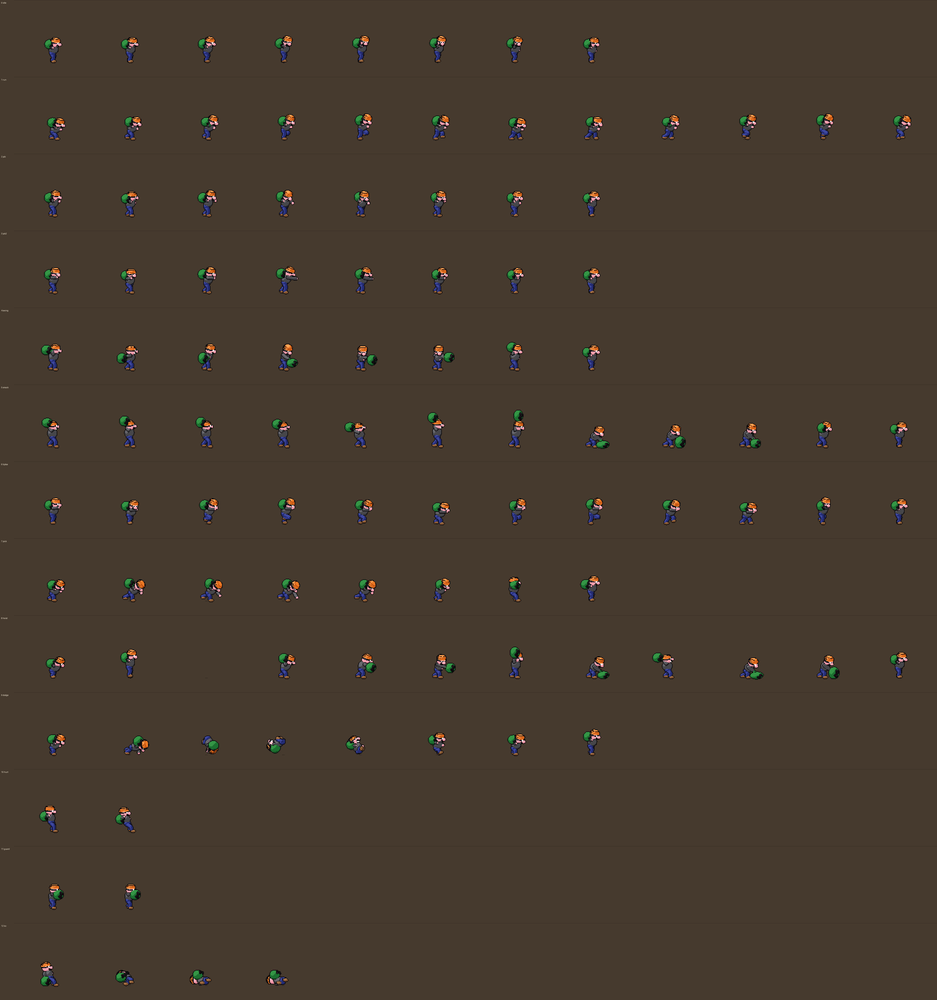

Facing down and up: [`pete_views_preview.png`](pete_views_preview.png).

| Row | Animation | Frames | Notes |
| --- | --- | --- | --- |
| 0 | idle | 8 | rocking on tiptoe (eased), a quick glance at the camera, held, and back; the bag 2 frames behind, the free hand 1 |
| 1 | run | 12 | the cartoon sneak: per step contact (squash), settle, a slow 3-frame knee lift to a freeze, a fast place; each foot planted 8 frames; the bag 2 frames behind the bob, the beanie 1 |
| 2 | jab | 8 | Sucker Punch (light 1): shoulder turned away, fist cocked low, whip, extension (held over the hit), recoil, back |
| 3 | jab2 | 8 | Cheap Shot (light 2): the same with the near fist (the bag passed to the far hand) |
| 4 | swing | 8 | Bag Swing (light 3): off the shoulder, wound back low, the arc, impact out front, overshoot past him, hoist |
| 5 | smack | 12 | Sack Smack: 0–3 the charge loop (`anim_charge` `[0, 4, 6]`), gather, rise, overhead whip, slam (the bag flat on the floor), bounce, drag, hoist, stance; Smash and Grab has its own `anim_at` from frame 5 |
| 6 | tiptoe | 12 | Tiptoe: "shhh" (near hand), sink and glance, two sneak steps (lift, freeze, place, contact), a freeze on one toe, stance (the game fades him out) |
| 7 | pick | 8 | Pickpocket: crouch (held through the windup), launch, dash, reach, snatch, loot to chest, skid, stance |
| 8 | heist | 12 | The Big Heist: crouch, spring, gone (frame 2 is empty), back, a 4-frame flurry (near side, far side, high, low), coil, the smack (the cut-in frame, `[8, 9]`), bounce, recover |
| 9 | dodge | 8 | a forward tuck and roll: crouch, dive, three tumbling frames, landing, squash, up |
| 10 | hurt | 2 | recoil; frame 1 doubles as the crumple pose |
| 11 | guard | 2 | hiding behind the money bag |
| 12 | ko | 4 | flat on his back, the bag beside him, x eyes |
| 13 | victory | 10 | counts the loot: frames 1-7 loop, the far hand digging in the bag and holding a gold coin up, grinning; then the bag back on his shoulder and a tip of the beanie (8-9, held) |
| 14 | idle_alt | 8 | the shifty look: head snaps one way, whips back, the other way, then a long look at the foe; played once after 5 s standing still |

### Sno Mercy — 128×128 frames, 12 × 15 (1536×1920 px)

`tools/gen_sno.py`, on the shared renderer. The rig: an icy cyan cone (a tapered tube from
his point to the rim) with a navy rim, a dome of shaved ice on top (red on his right half,
green on his left, white flecks picked out by a hash of each point), an angry face on the
front of the cone (eyes, slanted brows, gritted teeth, a crack), grey stick arms and legs,
red boxing gloves, brown shoes, and a syrup drip off his point. The cone tips about its
point for the headbutt, the slide and the head slam. In the side view he's turned a little
toward the camera (`SIDE_CHEAT`) so the face reads. Drawn at 0.8 scale, feet at
**x 64, y 104**; up and down sheets are **112×128**, feet at x 56, y 104 (down) and y 92 (up).

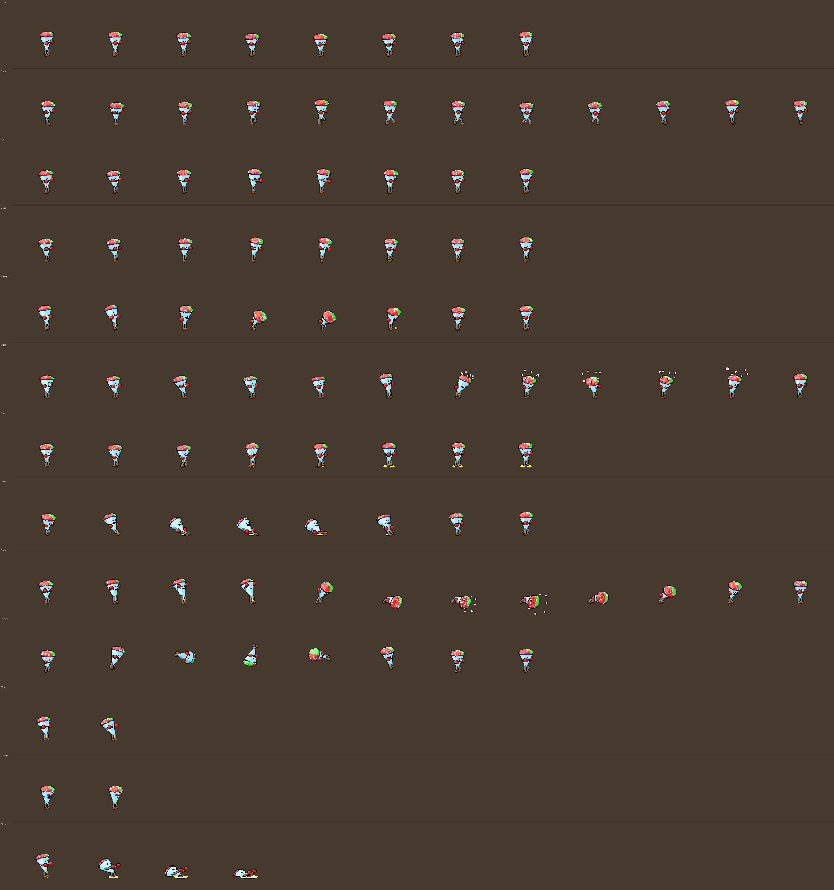

Facing down and up: [`sno_views_preview.png`](sno_views_preview.png).

The diagonals (`sno_down_side.png`, `sno_up_side.png`): **128×128**, feet at x 64, y 104
(`down_side`) and y 92 (`up_side`). `SIDE_CHEAT` applies to the side view only: the
45-degree `down_side` camera already shows his face, and `up_side` is a back three-quarter
view (the face is out of sight, as in the up view). Five views side by side:
[`anim_preview/sno_diagonals_3x.png`](anim_preview/sno_diagonals_3x.png).

Animated with the roster pass (the Crease recipe, `anim_preview/sno_motion_plan.md`; the
previews are `anim_preview/sno_*`): doubled frames on the same clock (`idle_ticks` 8 = a
64-tick idle, `run_ticks` 2), eased spacing, held releases, overlap on the gloves, drip,
shards and puddle, and a cone squash capped at 5% (`sq`; the gloves and stick limbs are
free). The rig's pass additions: `sq`, `knees` (a stick leg's knee bows by its slack as
the hip sinks), `yaw`, `pivot`, `carry` (limbs ride the cone in the tumble), `drip_sw`,
`blob`, `shard_a`, and `stick` (the dome's flecks picked in the dome's own coordinates, so
they don't sparkle in motion).

| Row | Animation | Frames | Notes |
| --- | --- | --- | --- |
| 0 | idle | 8 | a boxer's bounce, eased: up on his toes (stretched), down with the knees folded and the cone squashed; gloves a frame behind, the drip runs long after each landing |
| 1 | run | 12 | a boxer's advance: the cone upright and nearly rigid, the stick legs do contact, down, load, passing, up, reach (feet land on frames 0 and 6); gloves up, pumping a frame behind |
| 2 | jab | 8 | Cold Cross, the jab: dip, coil, snap, extension (held 3 ticks), overshoot, back, settle, return |
| 3 | cross | 8 | Cold Cross, the cross: load, the hips turn, the shoulders follow, extension with the whole cone turned (held 4), overshoot, back, settle, return |
| 4 | headbutt | 8 | Brain Freeze (light 3): rear, rear deep (held), the dome over on its arc, impact (held, squashed), follow-through flinging a drop of syrup, recoil, settle, return |
| 5 | spray | 12 | Shaved Ice Spray: frames 0-3 the charge loop (a head shake that builds, `anim_charge` [0, 4, 3]); then pinch, rear (held), the shake left / through / right / through (played twice) with the shards spraying, follow-through, recover |
| 6 | syrup | 8 | Syrup Slick: crouch, squeeze (held), the gush, the puddle spreading a frame behind, shake off, recover |
| 7 | slide | 8 | Slush Slide: lean in, thrown back, the slide (Cold Shoulder plays from frame 2), the lead foot rising, the kick, sit up, rise, settle |
| 8 | blast | 12 | Flavor Blast: brace, rear ×2, the gather (held 4), the slam (1 tick), the impact (held 5), the shards burst (frame 6, the cut-in), shards out, a slow rise ×3, stance |
| 9 | dodge | 8 | a full cartwheel in a hop about his middle, limbs tucked; crouch, spring, four roll frames, land, settle (2 ticks a frame) |
| 10 | hurt | 2 | recoil; frame 1 doubles as the crumple pose (frozen, tinted ice-blue by `CreatureView`) |
| 11 | guard | 2 | gloves up in front of his face |
| 12 | ko | 4 | topples and melts into a puddle |
| 13 | victory | 10 | the flex: frames 1-7 loop, both gloves pumping up beside his head, the cone wobbling, the syrup running; then one fist raised high (8-9, held) |
| 14 | idle_alt | 8 | brushes the snow off his dome with a glove (flecks fly), shakes it off, then glares at the foe; played once after 5 s standing still |

### Mister Crease — 128×160 frames, 12 × 16 (1536×2560 px)

`tools/gen_crease.py`, posed and splatted with the shared renderer but shaded by its own
paper pass (`render_paper`, swapped in for splat3d's `render` for this generator only), from
the concept art: an origami magician. Everything is faceted paper: polygonal prisms for the
limbs and the jacket, flat plates for the lapels, coat skirts, cape and shoes, a pleated
twelve-sector brim (the sectors tilt in turn like a fan) and a creased four-sided crown with
a folded tip. No face under the hat: a shadow and a red collar point. The hat stays nearly
level when he leans.

The paper look: every face is one flat tone (five per material, from the face normal), so
the big faces of the coat and hat read as clean planes with no dither. A crease between two
faces of the same sheet is a mountain fold (a lighter line where it catches the light) or a
valley fold (a darker line). The outline is drawn round the silhouette only; inside it a
piece in front of another gets a thin line in the back piece's deep tone where the depth
step is real, so arms, lapels and skirts separate by tone, not black lines. The pale paper
back (cream) shows wherever a flap turns over: the curled coat-skirt and cape-hem corners,
the lapels' folded edges, the underside of the brim, the paper plane's and the big crane's
undersides as they bank. Paper is light, so the cape has a mid fold that kinks (`wave`), the
coat tails swing a beat behind the stride (`tails`) and the brim flexes (`brim`).

Drawn at 1.1 scale (the figure is about 38×74 px with the hat; the hat tip is 73 px above
the feet, so `fx_top` is 74), feet at **x 64, y 136** (the frames are taller for the hat and
the victory crane); up and down sheets are **112×160**, feet at x 56, y 136 (down) and
y 124 (up). All 16 rows are in all three views (`ko` is still side-only in the data). The
crafts he carries between moves and the frogs he sends are drawn by `PaperFx`, not baked
into the frames; the ones in his hands during a fold or a throw are in the frames.

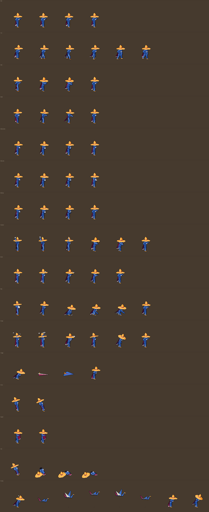

Facing down and up: [`crease_views_preview.png`](crease_views_preview.png).

The diagonals (`crease_down_side.png`, `crease_up_side.png`): **128×160**, feet at x 64,
y 136 (`down_side`) and y 124 (`up_side`), no cheat. The paper pass works for them
unchanged: `build` takes each view's camera from `S.Cam(view)`, so the paper backs, fold
lines and seams follow the diagonal cameras. All 16 rows are drawn. Five views side by
side: [`anim_preview/crease_diagonals_3x.png`](anim_preview/crease_diagonals_3x.png).

| Row | Animation | Frames | Notes |
| --- | --- | --- | --- |
| 0 | idle | 8 | hand on hip, the far palm up: an eased breath between presenting (chest up, palm raised) and settled (weight sunk); the brim a frame behind, the cape and tails two, the cape's fold three. `idle_ticks` 8 |
| 1 | run | 12 | the strut, two steps of contact, down, load, passing (knee high), push-off (heel up), reach (toe pointed); nearly upright, the far arm swinging on an arc with the fingers fanned out front; the planted foot slides back at an even pace; cape, fold, tails and brim lag 1 to 3 frames. `run_ticks` 2 |
| 2 | flick | 8 | Paper Cut (lights 1 and 3, Grand Entrance), near hand: anticipation, the coil (a dart pinched behind him, squashed, the cape whipped forward), the whip, the release (fingers fanned, stretched; the dart leaves on its second tick), follow-through, the flourish (palm up), settle, recover |
| 3 | flick2 | 8 | Paper Cut (light 2), the same with the far hand |
| 4 | fold_shuriken | 4 | a sheet lands in his hands, quick creases, the star, tucked into the hat band |
| 5 | fold_crane | 4 | the sheet, careful folds, the crane, set on his near hand |
| 6 | fold_frog | 4 | the sheet, folds, three little frogs in his hands, the frogs hopping off to his far shoulder (his hands free) |
| 7 | shuriken | 6 | Paper Shuriken: charge A/B (the star raised over the hat), rise, fling, follow-through, recover |
| 8 | crane | 5 | Paper Crane: hand up, the crane lifts, launched, follow-through, recover |
| 9 | frog | 6 | Paper Frog: he whips out a sheet, tears and folds three frogs, crouches to set them on the floor, the low forward sweep that sends them (the release, frame 3), the follow-through leaning in, recover; the frogs themselves are `PaperFx` projectiles once sent |
| 10 | surge | 12 | Thousand Cranes: 0-3 the charge loop (`anim_charge`: arms up, the sheets spiralling in to a crane over his hands); then the gather (squashed, the crane pulled back), the drive up and over, the throw (frame 6, the cut-in), the release (hand open, held), watching, the arm sweeping into the bow, the deep bow (held), the rise |
| 11 | dodge | 4 | Paper Plane: folds down, the airplane (two gliding frames, banking so its cream underside shows), unfolds |
| 12 | hurt | 2 | recoil, hat knocked askew, the brim bent back; frame 1 doubles as the crumple pose |
| 13 | guard | 2 | the cape swept up in front like a curtain, both hands holding its top corners above his shoulders, wider than him so it reads from behind too |
| 14 | ko | 4 | crumples like dropped paper, the hat rolling off |
| 15 | victory | 8 | folds into a giant crane, the flight loop (frames 1-5), unfolds, the bow |

## Animation pass: what worked (Mister Crease, Oct 2026)

A test of whether animation alone moves the generated sprites closer to 32-bit-era
quality, run on four of Crease's animations with his shading, palette and outlines
untouched. The motion plan, previews and side-by-side comparisons are in
[`anim_preview/`](anim_preview/) (`crease_motion_plan.md`; `python3 tools/gen_crease.py
anim` re-renders them).

**Frame counts:** idle 4 → 8, run 6 → 12, the flick 4 → 8 (both hands), the Surge 6 → 12
(4 of them a charge loop). Doubling was enough. The cycles keep their length in ticks
(idle 64 ticks, run 24) and run at a higher frame rate; the attacks keep their frame data
and only change `anim_at`.

**What made the biggest difference:**
- **Overlap, at a lag of 1 to 3 frames** (the brim a frame behind the body, the cape two,
  the cape's mid fold three, so a flap travels down to the hem). It costs nothing in
  posing, because it's the same curve sampled late, and it's what makes him read as paper.
- **Anticipation plus a held release.** A coil before the flick and a gather before the
  Surge's throw, then 3 to 5 ticks on the release pose. Inside the same startup the hit
  reads much harder.
- **Easing by spacing** (the idle's in-betweens bunched near its two key poses), which
  needs no repeated frames.
- **A run whose planted foot slides back at an even pace**, with the bob, squash on the
  down and the pointed toe; more upright posture for character.

**What didn't work, or needed care, at this size (about 38×74 px):**
- **Silhouette beats detail.** Poses that tucked a hand under the giant brim (the first
  coil and gather) vanished; the wind-ups had to be pulled back and below the brim, and
  the crane thrown past its edge. Check every key pose for what covers it.
- **Facing down, the brim still hides the throwing arm** at the flick's release, as it did
  before. That's a design problem (the brim's size), not an animation one.
- **Squash and stretch** is kept to about 7%; more looks like rubber, not paper.
- **Small moves** (wrist rolls, a hip sway under the shoulder roll) were dropped: under a
  pixel of travel they jitter or vanish.

**For other fighters:** the tools are shared now (`tools/CLAUDE.md`, "Animation tools";
the rollout plan is `anim_preview/roster_anim_plan.md`). `splat3d.tween` in-betweens any
generator's poses, with arcs for hands and paws; `splat3d.EASE_8` and `cycle()` give the
eased spacing; `lag()` (cycles) and `lag_at()` (attacks) give the overlap. `python3
tools/gen_<id>.py anim` renders any fighter's previews (the GIFs, the before/after
compare, the three views, the contact sheet), and `python3 tools/anim_preview.py --check
<id>` checks the JSON's row table, `anim_at`, `anim_charge`, `cut_in_frame` and the idle and
run cycles against the generator before the sheets go in. On the game side nothing new
is needed: per-fighter `idle_ticks` / `run_ticks`, `anim_at`, `anim_charge` for longer
charge loops. Start with the run and the lights, which show the most.

## Training dummy — 48×48 frames

4 columns × 2 rows. Row 0: idle, hurt A, hurt B, guard. Row 1: knock-over, 4 frames.

## Floor tiles — 8×8

One row of 10 tiles: 0–3 dirt variants, 4–7 cracked variants (each with a different
fracture direction), 8 pit with lit far rim, 9 deep pit.

## Arena art: one picture per map

`tools/gen_arenas.py` draws each map whole: `assets/sprites/arena_<id>.png` (1504×526:
the floor, walls and stands, plus `ArenaView.MARGIN` past them; pixel (0, 0) is world
(-400, -80)) with the map's pieces baked in as it starts (rubble walls, the water channel
and bridges, bushes, fences). Two floor-sized companions (672×288, the floor rect only):
`arena_<id>_cracked.png`, the same floor broken by one network of cracks, and
`arena_<id>_alt.png` (maps whose pieces change), the floor with each piece changed
(smashed walls as rubble, flattened brush). `ArenaView` shows a cell's piece of the
cracked or changed picture when the cell's state differs from the map's, so a cracked
patch joins up. A map without art falls back to the tiles below. The pieces' rects come
from `data/arenas/<id>.json`: move a piece there and rerun the generator.

## Caravan — 48×40

The Caravan's wagon (`assets/sprites/caravan.png`, `tools/gen_arenas.py:caravan_sprite`): four
frames of its wheels turning, facing right (mirrored heading left), ground contact at
(24, 36). The view adds the shadow, the push ring and the attackers' flag.

## Flag — 12×10

Capture the Flag's cloth (`assets/sprites/flag.png`, `tools/gen_arenas.py:flag_sprite`): four
waving frames, white, tinted the side's colour by the view, which also draws the pole.
Map chasms are baked into the arena art (`chasm_pit`); holes made in a fight still use the tiles.
Twin Keeps' shrines are stone daises in the art (`shrine_plinth`; the view draws the glow,
the sign and the claim), and its `_alt` picture has the river where the bridge stood, with
broken planks: a hole in a bridge, or the bridge fallen in, shows that piece.

## Crowd — 12×16

Four fan variants, two frames each (seated, cheering), in one row.

## Effects — 16×16

Row 0: hit spark, 4 frames. Row 1: dust puff, 4 frames (fading alpha). Row 2: Runoff
shockwave, 4 frames, facing right (mirrored when it travels left).

## Palette

One master palette for the whole game: `tools/palette.py`, drawn as a labelled swatch in
[`palette.png`](palette.png) (`python3 tools/palette.py` redraws it).

- **Lines and ramps.** The palette is a set of hue lines (red, wine, pink, orange, gold,
  rust, earth, green, moss, lime, teal, sky, blue, violet, steel, neutral, peach), each
  running dark to light, plus six outline inks: 106 colours for sprites. The peach line
  (ramps `salmon` and `peach`: Cerebro's brain, Hissy's skin) came later and is
  `NAMED_ONLY`: `nearest`, `snap`, `snap_ramp`'s best fit and `ramp_for` never land on it,
  so adding it changed no arena and no old triple; a generator names it to use it. A **ramp** is a named
  five-step window on a line: deep shadow, dark, base, light, highlight (`palette.RAMPS`,
  e.g. `"rust"`, `"ice"`, `"white"`); `palette.ramp(name, shift)` slides the window (+1
  one step lighter). Arena floors also get 18 **ground half-steps** (`palette.GROUND`:
  the earth, moss, steel and neutral lines with the midpoint between each middle pair),
  because a full step across a whole floor reads as a stain; sprites never use them.
- **Hue shift.** Shadows turn cooler and lights warmer, about 8° per step: yellows and
  oranges darken toward red (never toward green), greens and blues toward blue-violet;
  lights turn toward yellow. Each step is about 0.1 of perceptual lightness (OKLab L),
  so neighbouring steps always read as two tones at 1x.
- **Outlines.** A ramp's silhouette outline is its ink (`palette.ink_for`): the nearest of
  a few dark, greyed inks to its deep step (umber for browns and oranges, plum for reds,
  moss for greens, navy for blues, a soft pewter for white and ice, plain ink for greys
  and blacks), never pure black. Seams inside the silhouette use the ramp's deep step, one
  step lighter than its outline, so inner lines don't go muddy.
- **Using it in a generator.** A splat3d rig names a ramp per material in its `MAT` table
  (`"fur": "rust"`, `"belly": ("concrete", 1)`, `"slot": P.flat("ink")` for an unshaded
  colour); `splat3d.configure` still takes an old `(base, light, dark)` triple and snaps it
  through `palette.ramp_for(base)`. `splat3d.shade` then paints from the ramp: highlight
  (small), light and base on the lit side, a hard terminator, one dark step for the core
  shadow (low contrast, so round shapes keep their mass), a one-pixel rim light (one step
  up) on the shadowed edge facing away from the key light, a cleanup of lone pixels, and
  outlines in each material's ink. Crease keeps his faceted paper shader on the same
  ramps. Cerebro and Hissy keep their own rasterisers but hand the buffers (`cam`, `mat`,
  `nrm`, `z`, `part`) to `splat3d.shade` / `outline` after `S.configure(MAT, ...)`; they
  import the palette as `PAL` (their `P` is the pose constructor). The arenas snap every named colour, ramp and finished picture to the palette
  (`tools/gen_arenas.py`, `snap_constants` and `save`: floor ramps on the ground lines,
  blends and fades ordered-dithered between palette colours; crack masks and the flag,
  which the view tints, stay unsnapped).
- **Not ported yet:** Barkley, Gillbert, Craglash (own renderers) and the
  placeholders in `tools/gen_sprites.py` still use their own colours. Porting one is
  mostly rewriting its MAT table as ramp names and shading from the five steps.

Before/after comparisons from the pass that added it: [`palette/`](palette/).

## HUD portrait crop

The fighter panels show a head crop of the idle frame (`hud.gd:_draw_portrait`). The
sprite block's optional `"portrait": [x, y, w, h]` is that crop in the idle frame's own
pixels (w up to 24, h up to 32); without it the HUD takes the top of the picture's opaque
area, centred. The crop is scaled by whole multiples only (a smaller crop shows bigger),
never shrunk. Adding or changing it changes the creature data, so the online data hash
changes too (server `update.sh` after merge). Not drawn in Team Deathmatch and CTF (no room
beside the score boxes).
