# Gallery

Captured from the real game by `tools/capture_gallery.py` (a 1280x720 window, the
showcases and CPU-vs-CPU matches pressing buttons like players). Rebuild with
`python3 tools/capture_gallery.py all`; the trailer's raw beats with
`python3 tools/capture_gallery.py trailer [--movie]` (into `trailer/`, not committed;
the beat list is `tools/trailer_shots.json`).

## Fighters

Each fighter's showcase (`--showcase=<id>`): the GIF loops its last combo and
finisher (up to 6 s at 15 fps, 480 px; trimmed to fit 2.4 MB); the sheet samples the whole script.

### Cairn

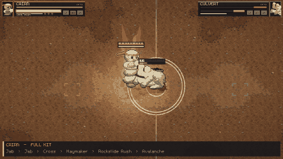

- [`fighters/cairn.gif`](fighters/cairn.gif): Cairn's showcase, combo and finisher, looping
- [`fighters/cairn_sheet.png`](fighters/cairn_sheet.png): six moments across the whole showcase

### Culvert

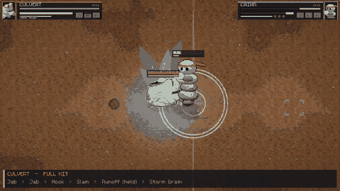

- [`fighters/culvert.gif`](fighters/culvert.gif): Culvert's showcase, combo and finisher, looping
- [`fighters/culvert_sheet.png`](fighters/culvert_sheet.png): six moments across the whole showcase

### Craglash

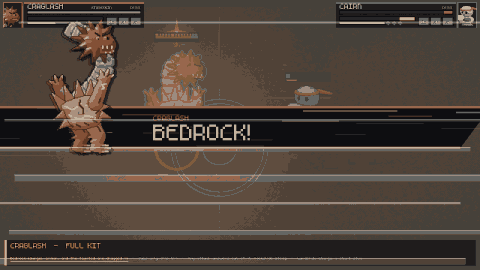

- [`fighters/craglash.gif`](fighters/craglash.gif): Craglash's showcase, combo and finisher, looping
- [`fighters/craglash_sheet.png`](fighters/craglash_sheet.png): six moments across the whole showcase

### Barkley

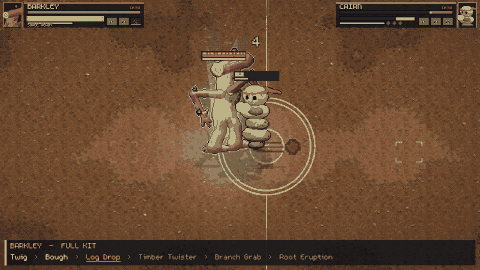

- [`fighters/barkley.gif`](fighters/barkley.gif): Barkley's showcase, combo and finisher, looping
- [`fighters/barkley_sheet.png`](fighters/barkley_sheet.png): six moments across the whole showcase

### Gillbert

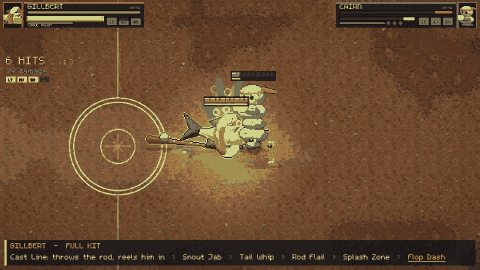

- [`fighters/gillbert.gif`](fighters/gillbert.gif): Gillbert's showcase, combo and finisher, looping
- [`fighters/gillbert_sheet.png`](fighters/gillbert_sheet.png): six moments across the whole showcase

### Chef Cerebro

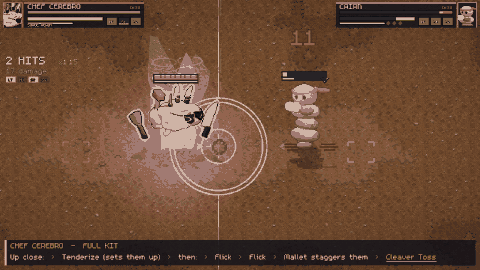

- [`fighters/cerebro.gif`](fighters/cerebro.gif): Chef Cerebro's showcase, combo and finisher, looping
- [`fighters/cerebro_sheet.png`](fighters/cerebro_sheet.png): six moments across the whole showcase

### Hissy Fitz

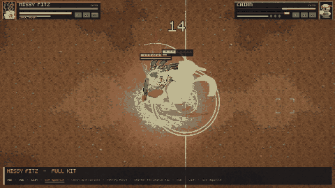

- [`fighters/hissy.gif`](fighters/hissy.gif): Hissy Fitz's showcase, combo and finisher, looping
- [`fighters/hissy_sheet.png`](fighters/hissy_sheet.png): six moments across the whole showcase

### Digby

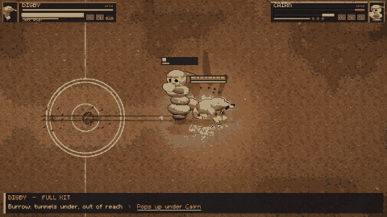

- [`fighters/digby.gif`](fighters/digby.gif): Digby's showcase, combo and finisher, looping
- [`fighters/digby_sheet.png`](fighters/digby_sheet.png): six moments across the whole showcase

### Sneaky Pete

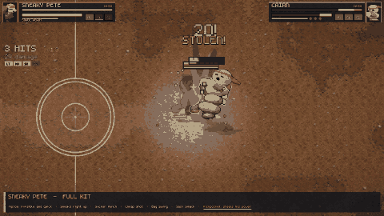

- [`fighters/pete.gif`](fighters/pete.gif): Sneaky Pete's showcase, combo and finisher, looping
- [`fighters/pete_sheet.png`](fighters/pete_sheet.png): six moments across the whole showcase

### Mister Crease

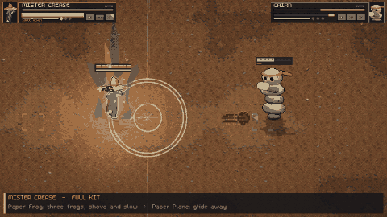

- [`fighters/crease.gif`](fighters/crease.gif): Mister Crease's showcase, combo and finisher, looping
- [`fighters/crease_sheet.png`](fighters/crease_sheet.png): six moments across the whole showcase

### Sno Mercy

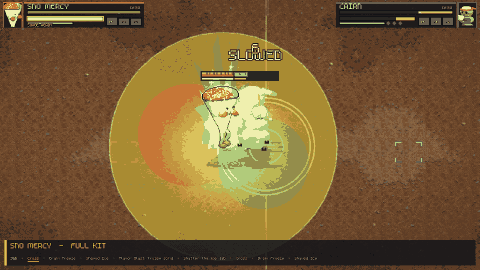

- [`fighters/sno.gif`](fighters/sno.gif): Sno Mercy's showcase, combo and finisher, looping
- [`fighters/sno_sheet.png`](fighters/sno_sheet.png): six moments across the whole showcase

## Maps

A CPU-vs-CPU match on each map at each time of day it allows (clear weather):
the wide shot frames the whole floor (`--cam`), then two moments of the fight.
The four map choices play a 3v3 team battle; Dustwind Pass is Caravan's map and
Twin Keeps is Capture the Flag's.

### Stadium

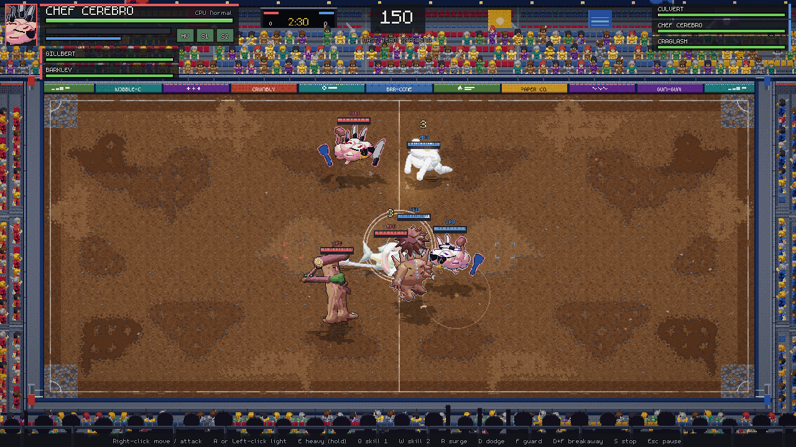

- [`maps/stadium_day_wide.png`](maps/stadium_day_wide.png): Stadium by day, the whole floor
- [`maps/stadium_sheet.png`](maps/stadium_sheet.png): a row per time of day (day, sunset): wide, then two action shots

### Quarry Bowl

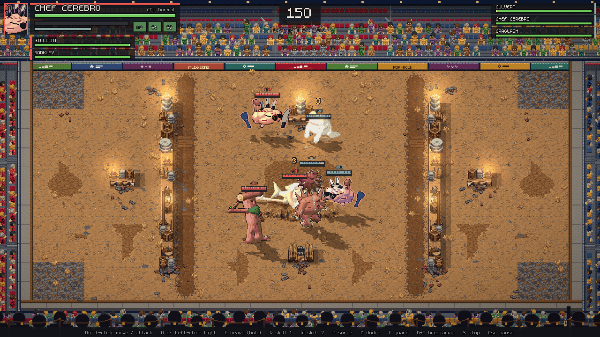

- [`maps/quarry_day_wide.png`](maps/quarry_day_wide.png): Quarry Bowl by day, the whole floor
- [`maps/quarry_sheet.png`](maps/quarry_sheet.png): a row per time of day (day, sunset): wide, then two action shots

### Floodgate Stadium

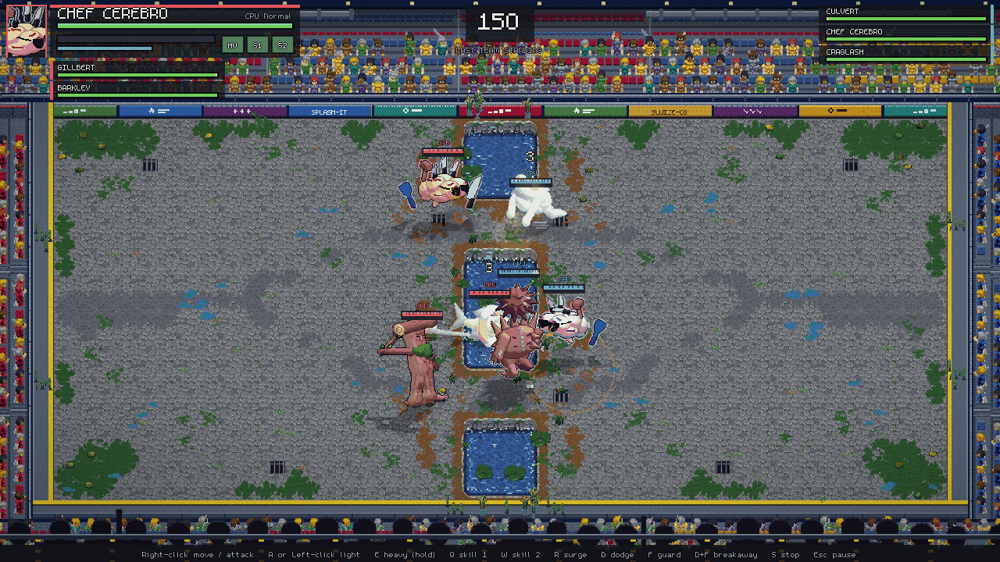

- [`maps/floodgate_day_wide.png`](maps/floodgate_day_wide.png): Floodgate Stadium by day, the whole floor
- [`maps/floodgate_sheet.png`](maps/floodgate_sheet.png): a row per time of day (day, sunset, night): wide, then two action shots

### Greenhouse Dome

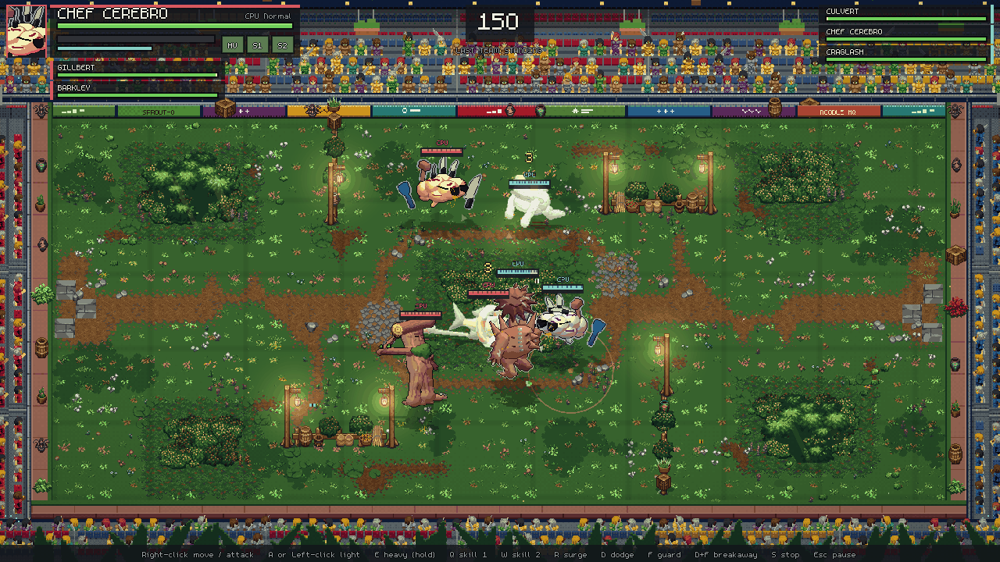

- [`maps/greenhouse_day_wide.png`](maps/greenhouse_day_wide.png): Greenhouse Dome by day, the whole floor
- [`maps/greenhouse_sheet.png`](maps/greenhouse_sheet.png): a row per time of day (day, sunset): wide, then two action shots

### Dustwind Pass

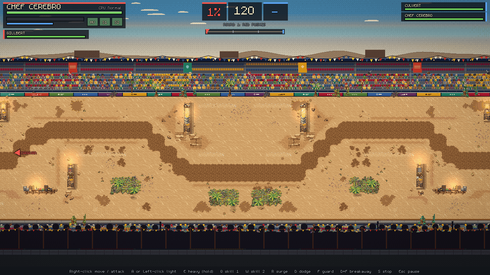

- [`maps/caravan_pass_day_wide.png`](maps/caravan_pass_day_wide.png): Dustwind Pass by day, the whole floor
- [`maps/caravan_pass_sheet.png`](maps/caravan_pass_sheet.png): a row per time of day (day, sunset): wide, then two action shots

### Twin Keeps

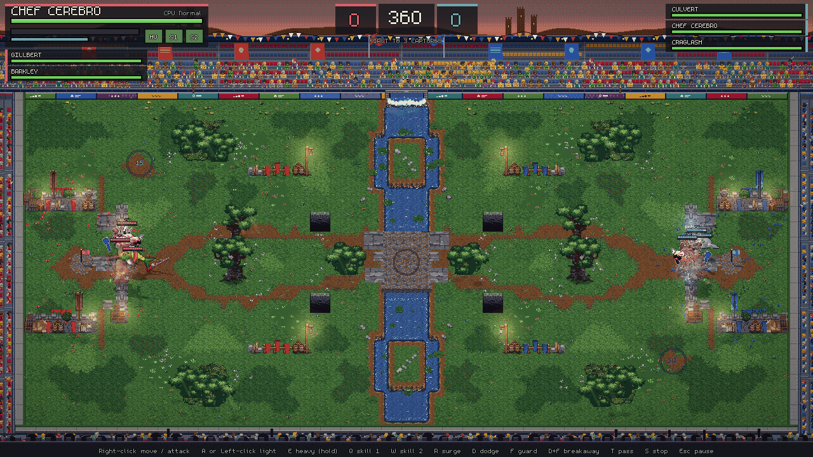

- [`maps/twin_keeps_day_wide.png`](maps/twin_keeps_day_wide.png): Twin Keeps by day, the whole floor
- [`maps/twin_keeps_sheet.png`](maps/twin_keeps_sheet.png): a row per time of day (day, sunset): wide, then two action shots

Committed here: 36.1 MB.
